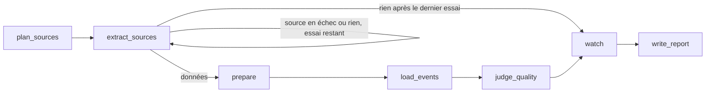

# Agent de collecte nocturne

**Son rôle** : être le gardien nocturne de la base, et la faire progresser.

- Chaque nuit, apporter des événements frais, fiables et sourcés, sans jamais
  dégrader la base en cas de panne, et ne prévenir que lorsqu'une
  intervention humaine est utile.
- Chaque lundi, lire ce que les gens ont cherché sans trouver et proposer de
  quoi y répondre : un synonyme, une correction, un agenda à lire.

Il propose, un humain décide : aucune configuration n'est modifiée sans
`uv run python -m agent.proposals --accepter N`.

Chaque nuit à 2 h (heure de Paris), l'agent met à jour la base d'événements de
Montpellier et du bassin de Thau. Il est déclenché par le DAG Airflow
`dags/sortiria_nightly_dag.py` en local, et par une tâche planifiée Azure
Container Apps Job en production (cron `0 1 * * *` en UTC, soit 2 h à Paris en hiver et 3 h en été).

Organisation reprise du graphe LangGraph de Chess Agent
(`reference/p13_agent/backend/app/agent/`, gardé comme référence) : services
injectés, nœuds, routage séparé, tout testable sans réseau.

| Fichier | Rôle |
| --- | --- |
| `state.py` | État partagé entre les nœuds |
| `services.py` | Services injectés : extraction (moteur CheckIt.AI), PostgreSQL, embeddings et appels Mistral, sources configurées, recherche d'un sujet dans les agendas OpenAgenda |
| `nodes.py` | Les étapes et les décisions de l'agent |
| `routing.py` | Après l'extraction : préparer, réessayer, ou aller au bilan |
| `graph.py` | L'enchaînement des nœuds et `run_nightly_collection()` |
| `watch.py` | La surveillance : programmes PDF à renouveler, partenaires à relancer, couverture par public et par zone, coût Mistral |
| `tracking.py` | Le suivi MLflow : une nuit = une exécution (paramètres, métriques, trace des appels Mistral) |
| `diagnosis.py` | Le diagnostic des pannes et la recherche d'une réparation (document déplacé) |
| `search_learning.py` | L'apprentissage des recherches ratées : lecture des mots par Mistral, synonymes vérifiés dans la base, agendas qui traitent un sujet absent |
| `proposals.py` | La validation humaine : `uv run python -m agent.proposals` (`--accepter N`, `--refuser N`) ; applique un agenda (`config/sources.yaml`), une adresse de PDF ou un synonyme (`config/synonymes.yaml`) |
| `report.py` | Le bilan envoyé par mail |
| `__main__.py` | Lancement manuel : `uv run python -m agent` (`--essai` : sans écrire en base, `--source` : une source précise, `--decouverte` : avec la découverte des agendas OpenAgenda, `--bilan-recherche` : seulement le bilan de la recherche, `--apprendre` : avec les propositions qui en découlent) |

## Le graphe

| Nœud | Ce qu'il fait |
| --- | --- |
| `plan_sources` | Choisit les sources de la nuit : OpenAgenda, DATAtourisme, calendriers iCal, programmes PDF, fichiers des partenaires, **seulement celles qui ont une configuration active**, moins celles coupées sur ce serveur (`SOURCES_DESACTIVEES`). Un `config/sources.yaml` illisible donne un bilan d'échec, pas un plantage |
| `extract_sources` | Lance les extracteurs CheckIt.AI (un adaptateur par API, un moteur « fichiers » commun à l'iCal et aux PDF lus par Mistral, le moteur « datasets » pour les partenaires). Au 2e essai, seulement les sources en échec : un extracteur relancé remplace son bilan du premier essai. Une exception devient une erreur tracée ; les tokens Mistral de la lecture des PDF sont relevés |
| `prepare` | Convertit en `Event`, valide (annulés, en ligne, offres d'emploi rejetés, chaque rejet compté par motif), déduplique titre + jour + heure + lieu, puis fusionne le même événement venu de deux sources (détail : page Sources, `docs/sources.md`) |
| `load_events` | Dans **une seule transaction** : partenaires et bilan de leurs fichiers, enregistrement, ménage des événements disparus, retrait des passés, plafond de 10 000, enrichissement et embeddings Mistral des nouveaux, modération des commentaires en attente, purge RGPD. Si une étape échoue, la base reste celle de la veille. Puis, à part : vocabulaire des titres recalculé et recherches de la semaine relues |
| `judge_quality` | Mistral juge 20 événements tirés au hasard (cohérence, sortie ou non, publics, catégorie) : score de qualité de la nuit. Une panne du juge laisse le score absent, sans faire échouer la nuit |
| `watch` | Surveillance et diagnostic (voir plus bas) ; calculée à partir de l'état et de la configuration, elle fonctionne aussi en mode essai et après un échec total. Le lundi : bilan de la recherche et apprentissage |
| `write_report` | Statut (`success`, `partial_success`, `failed`), alertes, bilan dans `collect_runs` et détail par source dans `collect_run_sources`, propositions dans `agent_proposals`, envoi du bilan par mail |

Chaque nuit est écrite **en entier ou pas du tout** : jamais une base à moitié
mise à jour. En retour, rien à l'intérieur de la transaction ne doit lever
d'exception évitable : un lot d'enrichissement ou d'embeddings en échec est
journalisé et passé (avant le 15/10/2026, une seule erreur d'embeddings
annulait toute la nuit, enrichissements payés compris), et un événement hors
contrainte est ramené dans les valeurs admises avant l'écriture
(`event_validator.conform_to_schema`).

## Agent ou ETL ? Ce que LangGraph apporte vraiment

Un ETL bien écrit (un DAG Airflow, par exemple) sait aussi **réessayer**,
**traiter les erreurs** et **brancher selon une condition**. Ce n'est donc
pas là que se fait la différence, et SortirIA ne le prétend pas : les
décisions de routage du tableau ci-dessous (réessayer une source, garder les
événements de la veille, ne pas balayer une source partielle) sont des
**règles écrites dans le code**, qu'un ETL pourrait porter.

Ce qu'un ETL ne fait pas, ce sont les étapes qui demandent de **comprendre
un texte** et de **juger** :

| Étape | Pourquoi il faut un modèle de langage | Garde-fou |
| --- | --- | --- |
| Lire un **programme PDF** (source non structurée) et en tirer des événements | la mise en page varie d'une page à l'autre, il n'y a pas de schéma à extraire | titre présent dans la page, date dans la période ; sinon rejeté |
| Lire le **PDF ou le document Word d'un partenaire**, mis en page à sa façon (16/10/2026) | une plaquette n'a pas de colonnes ; Mistral range chaque séance dans celles du modèle | mêmes contrôles qu'un tableur, titre présent dans le texte ; **import proposé, publié après validation humaine** |
| **Enrichir** chaque événement (catégorie, publics, résumé) | « Atelier jeux en famille » n'a pas de champ « public » dans la source | liste fermée, résumé sans nom ni nombre inventé |
| **Juger** la qualité d'un échantillon chaque nuit | vérifier la cohérence titre / catégorie / résumé demande de lire | un autre modèle que celui qui enrichit ; alerte sous 80 % |
| **Lire les recherches ratées** (« zumba », « cirqe ») | distinguer une faute, un synonyme, un sujet, une ambiance | synonyme vérifié dans la base ; **proposé**, appliqué après validation humaine |
| **Diagnostiquer** une panne | comprendre un message d'erreur, chercher la nouvelle adresse d'un PDF | réparation **proposée**, jamais appliquée seule |

Ce que **LangGraph** apporte pour les orchestrer : un **état partagé**
(sources, événements, coût, alertes) que chaque nœud lit et complète ; un
**routage** après chaque étape selon ce qui s'est passé ; des **services
injectés**, donc un graphe entier testable sans réseau ni Mistral ; une
**trace** de chaque nœud et de chaque appel au modèle (MLflow). Et une
porte ouverte : une nouvelle source non structurée (pages HTML des lieux) est
un nœud de plus du même type que la lecture des PDF.

Dit simplement : **sans les étapes qui lisent et jugent, un ETL suffirait.**
SortirIA est un *pipeline agentique* (des règles pour le routage, un modèle
pour les jugements, un humain pour les changements de configuration), pas un
agent qui planifie seul ; sur des données publiques, c'est un choix.

## Les décisions de l'agent

Les décisions de routage et de surveillance, nuit après nuit :

| Situation | Décision |
| --- | --- |
| Une source n'a aucune configuration active (aucun calendrier iCal déclaré) | Elle n'est pas lancée (sinon : fausse panne chaque nuit) |
| Une source est coupée sur ce serveur (`SOURCES_DESACTIVEES=document`, 15/10/2026 : Sète agglopôle renvoie une page web au lieu du PDF aux serveurs d'Azure) | Elle n'est pas lancée, ses événements ne sont pas balayés, le mail le signale ; elle reste lisible depuis une autre machine (`python -m agent --source document`) |
| Une ou plusieurs sources sont en échec | Nouvel essai de **ces sources seulement** ; leurs événements s'ajoutent à ceux des autres |
| Rien n'a été extrait | Nouvel essai de tout, puis bilan d'échec : l'agent ne s'arrête jamais sans trace |
| Une source est en échec, ou en échec partiel (un PDF sur deux en 404, un agenda OpenAgenda en quota) | Les autres continuent ; statut « partiel » ; ses événements de la veille sont gardés |
| Une source répond mais apporte moins de la moitié de son meilleur total des 7 dernières nuits (au moins 20) | Alerte « baisse anormale », statut « partiel », ses événements de la veille sont gardés |
| Un événement à venir a disparu de sa source (retiré, ou désormais refusé) | Il est supprimé, mais seulement pour une source lue en entier, sans échec ni baisse anormale ; un événement passé est gardé 7 jours pour la notation |
| Plus de 20 % des événements sont rejetés | Alerte |
| Un programme PDF se termine dans moins de 21 jours (ou est terminé) | Rappel « chercher le prochain programme » |
| Un fichier partenaire n'a plus de séance à venir, ou n'a pas changé depuis 30 jours | Rappel « relancer le partenaire », seulement si les fichiers des partenaires ont été lus sans échec cette nuit (sinon chacun recevrait « plus aucune séance » à tort) |
| Un partenaire a déposé un PDF ou un document Word, pas encore validé | Lu par Mistral (une fois, mis en cache), séances comptées, **proposition** « importer » avec un aperçu ; rien n'est publié avant l'accord (`uv run python -m agent.proposals --accepter N`) |
| Moins de 10 sorties « famille » ou « soirée » à Montpellier ou sur le bassin de Thau dans les 7 jours (compté dans la base, toutes sources confondues) | Rappel « couverture faible » (la promesse du service) |
| Le coût Mistral estimé de la nuit dépasse le budget | Alerte |
| Nouvel événement, ou texte modifié | Enrichi par Mistral (lots de 15, 3 000 par nuit au plus) : catégorie unifiée parmi 18 (chaque source a son propre vocabulaire), publics (famille, soirée, ados, seniors), résumé d'une phrase ; signalé s'il ne s'agit pas d'une sortie (`is_outing` faux : gardé en base, mais plus proposé par la recherche), jamais supprimé pour autant. La tranche de prix est calculée sans modèle ; la catégorie et le résumé entrent dans le texte vectorisé, ce qui aide la recherche. Une catégorie hors liste devient « autre » au lieu de faire perdre publics et résumé ; accents et variantes (« Théâtre », « enfants ») sont ramenés à la liste (14/10 : plus de la moitié des lots perdus pour cela). Changer la consigne (`ENRICHMENT_VERSION`) fait ré-enrichir tous les événements à venir. Contrôles (15/10) : un titre explicite (« Pause jeux », « Visite guidée ») fixe la catégorie ; un résumé qui cite un nom ou un nombre absent de la source est écarté (16/10 : les siècles en chiffres romains, « DJ », les âges et les prix ne comptent plus comme inventés) |
| Le même événement publié par deux sources (titres écrits autrement) | Fusionné : même jour, même commune, heures compatibles, titres presque identiques ; la fiche du partenaire, sinon d'OpenAgenda, est gardée et complétée par l'autre |
| Score du juge de qualité sous 80 % | Alerte, avec des exemples de problèmes (16/10 : le juge connaît la liste fermée des catégories et ne reproche plus « marché » au lieu de « brocante ») |
| Des commentaires clients attendent une modération (service indisponible au moment du dépôt) | Modérés par Mistral Moderation (publiés ou refusés) |
| Mistral ne répond pas (quota, clé, panne) | Enrichissement, embeddings, juge et modération sont passés pour cette nuit et repris la suivante ; les événements sont quand même écrits. Trois lots d'embeddings en échec de suite arrêtent les embeddings de la nuit |
| Un partenaire a 2,5/5 ou moins sur 5 notes clients au moins | Alerte « à contacter » |
| La base dépasse 10 000 événements | Les plus lointains sont retirés (statistiques gardées) et une alerte est envoyée ; alerte dès 90 % |
| C'est le jour de la découverte (`discovery_weekday`, dimanche par défaut), ou `--decouverte` | Recherche complète des agendas OpenAgenda (~6 min) ; chaque agenda utile absent de `agenda_uids` devient une **proposition** « ajouter l'agenda » (nombre d'événements dans la zone, lien), jamais ajoutée seule ; un agenda refusé n'est plus reproposé |
| Une source tombe en panne | Diagnostic (document déplacé, accès refusé, accès bloqué par le site, quota, réseau, format) et conseil ; pour un document déplacé, l'agent cherche et vérifie la nouvelle adresse, puis **propose** la réparation, appliquée seulement après accord humain |
| Chaque nuit, après l'écriture | Vocabulaire des titres recalculé : les sujets que la recherche reconnaît (« photo » est un sujet, « romantique » une ambiance) |
| C'est lundi | Bilan de la recherche des 7 derniers jours dans le mail, puis, pour chaque mot cherché au moins 2 fois et absent de la base : **proposition** de synonyme ou de correction, **proposition** d'agenda OpenAgenda qui traite le sujet, ou piste pour les partenaires (détail plus bas) |

Le statut d'une source vient du bilan de son extracteur : `ok` (`success`
ou `empty`), `partiel` (`partial_success` : des événements, mais une partie
de la lecture a échoué) ou `echec` (`failed`). Le statut de la nuit en
découle : `success` si tout a été lu, `partial_success` dès qu'une source est
en échec ou en baisse anormale, ou qu'une erreur est tracée, `failed` si rien
n'a été gardé. Les rappels de surveillance (programme, partenaire,
couverture, coût, qualité) figurent dans le mail mais ne changent pas le
statut : ce ne sont pas des pannes, mais quelqu'un doit agir.

## Propositions et validation humaine

Ce que l'agent ne fait jamais seul, il le **propose** : une ligne
`en_attente` dans `agent_proposals`, citée dans le mail. Un humain les liste
avec `uv run python -m agent.proposals`, puis `--accepter N` (statut
`appliquee`, ou `acceptee` si le changement reste à faire à la main) ou
`--refuser N` (`refusee`). Une proposition déjà en attente n'est pas
dupliquée ; une proposition refusée n'est jamais reproposée. Un changement
accepté est pris en compte à la collecte suivante.

| Action | D'où elle vient | Ce que fait `--accepter` |
| --- | --- | --- |
| `remplacer_url` | Diagnostic d'un document déplacé | Remplace l'ancienne adresse par la nouvelle dans `config/sources.yaml`, seulement si l'ancienne y figure exactement une fois ; sinon rien n'est touché |
| `ajouter_agenda` | Découverte du dimanche, ou sujet absent cherché le lundi | Ajoute l'agenda à la fin de `agenda_uids`, avec un commentaire (nombre d'événements, date) ; le fichier garde ses commentaires et ses fins de ligne |
| `ajouter_synonyme` | Recherches ratées du lundi | Ajoute « mot tapé : mot connu » à `config/synonymes.yaml` |
| `valider_document_partenaire` | PDF ou Word déposé par un partenaire | Inscrit le fichier et son empreinte dans `_documents_valides.json` (voir `docs/partenaires.md`) |

Le diagnostic (`agent/diagnosis.py`) classe chaque échec de la nuit d'après
son message, sans modèle de langage :

| Diagnostic | Reconnu à | Conseil ou action |
| --- | --- | --- |
| `document_deplace` | 404, « introuvable » | Même nom de fichier cherché dans les dossiers mensuels voisins (convention WordPress `uploads/AAAA/MM/`, 6 mois avant, 2 après), adresse vérifiée (réponse 200, c'est bien un PDF), puis **proposée** |
| `acces_bloque` | page web reçue au lieu du document | Lire depuis une autre machine et couper la source sur ce serveur (`SOURCES_DESACTIVEES`) |
| `acces_refuse` | 401, 403 | Vérifier la clé de l'API dans le `.env` : elle a pu expirer |
| `quota` | 429 | Relue la nuit suivante ; espacer les appels si cela dure |
| `reseau` | délai dépassé, 502 à 504 | En général passager, à surveiller |
| `format_inattendu` | JSON illisible, « n'est pas un PDF » | La source a peut-être changé de format : vérifier l'adaptateur |
| `inconnue` | autre | Voir le journal (`logs/pipeline.log`) |

## Calibrage (14/10/2026)

| Réglage | Valeur | Où |
| --- | --- | --- |
| Essais d'extraction | 2 (le 2e pour les sources en échec seulement) | `routing.DEFAULT_MAX_ATTEMPTS` |
| Baisse anormale | moins de 50 % cette nuit du meilleur des 7 derniers bilans réussis de la source, s'il valait au moins 20 (le meilleur, pas le dernier : une nuit déjà en baisse ne sert pas de référence) | `nodes.DROP_MIN_PREVIOUS`, `DROP_RATIO` |
| Alerte de rejets | plus de 20 % | `nodes.REJECTION_ALERT_RATIO` |
| Enrichissement par nuit | 3 000 au plus, par lots de 15 | `nodes.MAX_ENRICHMENTS_PER_RUN`, `ENRICHMENT_BATCH_SIZE` |
| Embeddings par nuit | 10 000 au plus, par lots de 64 ; un lot en échec est passé, trois de suite arrêtent les embeddings de la nuit | `nodes.MAX_EMBEDDINGS_PER_RUN`, `EMBEDDING_BATCH_SIZE`, `MAX_EMBEDDING_FAILURES` |
| Échantillon du juge | 20 événements | `quality_judge.SAMPLE_SIZE` |
| Événement passé gardé pour la notation | 7 jours après la fin | `event_repository.RATING_WINDOW_DAYS` |
| Fin de programme PDF | 21 jours avant | `watch.DOCUMENT_EXPIRY_WARNING_DAYS` |
| Partenaire inactif | 30 jours sans mise à jour | `watch.PARTNER_STALE_DAYS` |
| Alerte de capacité | 90 % du plafond | `watch.CAPACITY_WARNING_RATIO` |
| Découverte des agendas OpenAgenda | le dimanche (6) | `discovery_weekday` dans `config/sources.yaml` |
| Bilan et apprentissage de la recherche | le lundi, 7 derniers jours | `watch.SEARCH_REPORT_WEEKDAY`, `SEARCH_REPORT_DAYS` |
| Mots appris par semaine | 5 au plus, cherchés au moins 2 fois | `search_learning.MAX_WORDS`, `MIN_TIMES` |
| Couverture | 10 sorties par case et par semaine | `.env` : `COUVERTURE_MIN_SEMAINE` (0 : désactivé) |
| Budget Mistral | 0,50 $ par nuit | `.env` : `MISTRAL_BUDGET_NUIT_USD` |

Le coût est une estimation : tokens réels pour la lecture des PDF, estimés
(4 caractères par token) pour les embeddings, dont l'API ne renvoie pas le
nombre ; tarifs dans `watch.PRICES_USD_PER_MILLION` (par million de tokens,
entrée / sortie : `mistral-small` 0,10 / 0,30 $, `mistral-medium` 0,40 /
2,00 $, `mistral-embed` 0,10 $ ; un modèle inconnu est compté au prix
fort), à vérifier sur la page de Mistral.

## Paramètres (`.env`)

Deux endroits : le `.env` (secrets et réglages d'exploitation, jamais
commité, modèle dans `.env.example`) et `config/sources.yaml` (les sources,
commité, voir `docs/sources.md`). Les seuils du code sont les constantes
nommées du calibrage ci-dessus.

| Variable | Rôle | Par défaut |
| --- | --- | --- |
| `DATABASE_URL` | la base PostgreSQL | — |
| `MISTRAL_API_KEY`, `OPENAGENDA_API_KEY`, `DATATOURISME_API_KEY` | clés des services ; une clé absente met la source en échec, jamais l'agent | — |
| `EMBEDDING_MODEL` | vecteurs des événements (1 024 dimensions) | `mistral-embed` |
| `DOCUMENT_EXTRACTION_MODEL`, `DOCUMENT_CALL_PAUSE_S` | lecture des PDF, pause entre deux appels | `mistral-small-latest`, 3 s |
| `ENRICHISSEMENT_ACTIF`, `ENRICHMENT_MODEL` | enrichissement des événements | actif, `mistral-small-latest` |
| `JUGE_ACTIF`, `JUDGE_MODEL`, `QUALITE_MIN` | juge de qualité et seuil d'alerte | actif, `mistral-medium-latest`, 0,80 |
| `LEARNING_MODEL` | lecture des recherches ratées | `mistral-small-latest` |
| `MODERATION_MODEL` | modération des commentaires | `mistral-moderation-latest` |
| `SOURCES_DESACTIVEES` | sources coupées sur ce serveur (`document` sur Azure) | aucune |
| `SORTIRIA_MAX_EVENEMENTS` | plafond de la base | 10 000 |
| `COUVERTURE_MIN_SEMAINE` | sorties minimales par case famille / soirée × zone sur 7 jours (0 : désactivé) | 10 |
| `MISTRAL_BUDGET_NUIT_USD` | budget d'alerte d'une nuit | 0,50 $ |
| `MLFLOW_ACTIF`, `MLFLOW_TRACKING_URI`, `MLFLOW_EXPERIMENT` | suivi des nuits | actif, SQLite local (`data/mlflow/mlflow.db`) sans serveur, `sortiria-collecte` |
| `REPORT_EMAIL_TO`, `REPORT_EMAIL_WHEN`, `SMTP_*` | bilan par mail : `toujours` ou `alertes` | pas de mail sans destinataire |

## Bilan par mail

À la fin de chaque collecte, l'agent envoie son bilan à l'adresse du `.env`
(`REPORT_EMAIL_TO`, plusieurs adresses possibles, séparées par des virgules).
Le sujet donne le statut d'un coup d'œil, par exemple
« [SortirIA] Collecte PARTIEL : 1059 événement(s), 1 alerte(s) ». Le corps
reprend les chiffres, le détail par source, les sources non lancées, les
alertes, les diagnostics et les propositions à valider, et le coût estimé. `REPORT_EMAIL_WHEN=alertes` limite l'envoi aux nuits avec un problème.

Le mail passe par SMTP (bibliothèque standard de Python, `src/utils/mail_utils.py`) :
pour Gmail, il faut un mot de passe d'application. Un mail qui ne part pas est
journalisé mais ne fait jamais échouer la collecte, et aucun mail n'est envoyé
en mode essai (`--essai`).

## Bilan de la recherche (15/10/2026)

Après chaque collecte, l'agent recalcule le **vocabulaire des titres**
(`sortiria.refresh_title_vocabulary()`, table `title_vocabulary`) : les mots
que la recherche reconnaît comme sujets. Chaque **lundi**, le mail ajoute ce
que les utilisateurs ont cherché sans trouver pendant les 7 derniers jours,
d'après le journal `rag_requests` :

- questions posées, sans réponse exacte, sans aucune proposition sur le sujet ;
- mots cherchés qui ne figurent dans aucun titre (« zumba (4) ») : une source,
  un partenaire ou un synonyme à envisager ;
- questions sans réponse exacte les plus fréquentes.

Comme pour les sources, l'agent signale et propose ; il ne change rien seul.
À la demande : `uv run python -m agent --bilan-recherche`. Ce qui a manqué à
chaque question est gardé dans `rag_requests.constraints -> 'recherche'`
(voir la page Interface, `docs/interface.md`) : le bilan ne compte que les
questions posées depuis le 15/10/2026.

### L'agent apprend des recherches ratées (`agent/search_learning.py`)

Le lundi, pour chaque mot cherché au moins 2 fois et écrit dans aucun titre
(5 au plus par semaine) :

1. **Mistral dit ce que c'est** : faute de frappe (« cirqe »), synonyme
   (« zumba », « stand-up »), sujet à part entière (« escalade ») ou ambiance
   (« romantique »), avec quelques mots équivalents.
2. **Faute ou synonyme** : le premier équivalent **présent dans les titres de
   la base** devient une proposition `ajouter_synonyme` (« zumba » cherchera
   aussi « fitness »). Un équivalent inconnu de la base n'est jamais proposé :
   il ne servirait à rien.
3. **Sujet absent** : l'agent le cherche dans les agendas OpenAgenda de la
   zone qu'on ne lit pas encore ; chaque agenda qui en propose devient une
   proposition `ajouter_agenda` (même circuit que la découverte). Sinon : une
   piste dans le mail (« à proposer aux partenaires »).
4. **Ambiance** : rien, la recherche par le sens s'en charge.

Une fois acceptée (`uv run python -m agent.proposals --accepter N`), la
proposition modifie `config/synonymes.yaml` ou `config/sources.yaml` ; la
recherche relit les synonymes dès qu'ils changent. La boucle complète est
testée sur une vraie base : « de la zumba » ne trouve rien, puis trouve le
cours de fitness une fois le synonyme accepté.

À la demande, sans attendre lundi :
`uv run python -m agent --bilan-recherche --apprendre`.

## Ce que l'agent a fait pour de vrai

| Date | Ce qui s'est passé | Ce que l'agent en a tiré |
| --- | --- | --- |
| 14/10/2026 | Le PDF de l'Agglopôle passe du dossier `uploads/2026/08/` à `uploads/2026/09/` | Ce cas a motivé le diagnostic : l'agent trouve désormais seul la nouvelle adresse et la propose |
| 14/10/2026 | Une pagination perdue (le lien « page suivante » perdait ses paramètres) fait tomber DATAtourisme à 184 séances au lieu de près de 1 000 | C'était sa toute première collecte, sans historique de comparaison ; la même panne survenant après des nuits normales déclencherait l'alerte « baisse anormale » dès la nuit même, sans vider la base |
| 15/10/2026 | Le juge relève « MHSC vs Nantes » dans un résumé, alors que la source annonce Metz | Erreur d'enrichissement repérée par le contrôle croisé ; depuis, un résumé qui cite un nom absent de la source est écarté |
| 15/10/2026 | Le juge relève « ANNULÉ - Monte-Cristo » et « Aide aux devoirs » | Ces deux cas sont maintenant rejetés à la préparation (titre qui annonce l'annulation, service qui n'est pas une sortie) |
| 15/10/2026 | 8 enrichissements refusés chaque nuit | Le journal a montré la cause (une catégorie hors liste, « dégustation ») : elle est maintenant rangée en « autre » |
| 15/10/2026 | Sète agglopôle renvoie une page web au lieu du PDF aux serveurs d'Azure | Nouveau diagnostic « accès bloqué » ; source coupée sur Azure et lue depuis un poste de travail |
| 15/10/2026 | Première découverte des agendas OpenAgenda | 5 nouveaux agendas proposés, 14 événements de plus dans la zone (102 au lieu de 88) |

Chiffres de la collecte du 14/10/2026 : 1 059 événements, 780 autour de
Montpellier, 279 sur le bassin de Thau (986 DATAtourisme, 73 OpenAgenda),
802 embeddings calculés, en 1 min 46 s.

Durée et coût d'une nuit, mesurés le 15/10/2026 (environ 2 500 événements :
DATAtourisme ~1 950 séances, programme PDF de Sète ~440, OpenAgenda ~90,
partenaires fictifs 15) :

| Nuit | Durée | Coût Mistral | Ce qui se passe |
| --- | --- | --- | --- |
| Après un changement de consigne | ~6 min | ~0,04 $ | environ 700 événements ré-enrichis et vectorisés |
| Ordinaire | ~2 min 15 | ~0,005 $ | seuls les nouveaux ou les modifiés sont enrichis |
| Dimanche (découverte) | ~9 min | ~0,005 $ | plus la recherche complète des agendas, sans appel à Mistral |

La première collecte sur une base vide coûte environ 0,14 $ (`docs/couts.md`).

## À venir

Le nœud de lecture par Mistral des pages et fichiers sans structure (programme
d'un lieu en HTML ou en PDF), bloc 5 de la feuille de route. Le LLM ne créera
jamais un événement sans URL ni date, et chaque sortie sera validée avant
d'entrer en base.

## Suivi

Chaque nœud est chronométré (`graph.timed`) ; chaque nuit est enregistrée
dans `collect_runs` (coût, tokens, couverture, durées, alertes, lien MLflow),
suivie dans MLflow (`tracking.py`) et visible dans Grafana. Voir
`monitoring/README.md`.

La base garde l'histoire : `collect_runs` (une ligne par nuit),
`collect_run_sources` (une ligne par source et par nuit, base de l'alerte
« baisse anormale »), `deleted_event_stats` (ce qui a été supprimé et
pourquoi, sans garder les fiches), `agent_proposals`. Le journal détaillé
est dans `logs/pipeline.log`. Le suivi ne fait jamais échouer la nuit : si
le serveur MLflow ne répond pas en 3 s, la collecte continue sans lui.

## Les décisions « LLM » et leurs garde-fous

| Décision | Modèle | Garde-fous |
| --- | --- | --- |
| Enrichissement (catégorie, publics, résumé) | `mistral-small-latest` | Liste fermée de catégories et de publics, validation Pydantic, une phrase tirée du texte ; n'efface jamais les données des sources ; les publics des sources sont conservés |
| Juge de qualité | `mistral-medium-latest` | Un autre modèle que celui de l'enrichissement ; quatre questions fermées ; un contrôle, jamais une modification |
| Lecture des recherches ratées (faute, synonyme, sujet, ambiance) | `mistral-small-latest` (`LEARNING_MODEL`) | Réponse JSON contrôlée (mots demandés seulement, natures connues, un mot par équivalent) ; un synonyme n'est proposé que s'il existe dans les titres de la base ; un agenda seulement s'il a des événements du sujet dans la zone ; un humain décide, une proposition refusée n'est jamais reproposée |
| Diagnostic et réparation | pas de LLM (règles + vérification de l'adresse) | L'agent propose, un humain décide ; rien n'est modifié sans `--accepter` |
