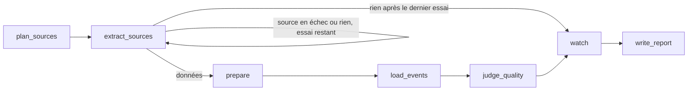

# Agent de collecte nocturne

**Son rôle** : être le gardien nocturne de la base. Chaque nuit, apporter des
événements frais, fiables et sourcés, sans jamais dégrader la base en cas de
panne, et ne prévenir que lorsqu'une intervention humaine est utile.

Chaque nuit à 2 h (heure de Paris), l'agent met à jour la base d'événements de
Montpellier et du bassin de Thau. Il est déclenché par le DAG Airflow
`dags/sortiria_nightly_dag.py` en local, et par une tâche planifiée Azure
Container Apps Job en production (même cron : `0 2 * * *`).

Organisation reprise du graphe LangGraph de Chess Agent
(`reference/p13_agent/backend/app/agent/`) : services injectés, nœuds,
routage séparé, tout testable sans réseau.

| Fichier | Rôle |
| --- | --- |
| `state.py` | État partagé entre les nœuds |
| `services.py` | Services injectés : extraction (moteur CheckIt.AI), PostgreSQL, embeddings Mistral, sources configurées |
| `nodes.py` | Les étapes et les décisions de l'agent |
| `routing.py` | Après l'extraction : préparer, réessayer, ou aller au bilan |
| `graph.py` | L'enchaînement des nœuds et `run_nightly_collection()` |
| `watch.py` | La surveillance : programmes PDF à renouveler, partenaires à relancer, couverture par public et par zone, coût Mistral |
| `tracking.py` | Le suivi MLflow : une nuit = une exécution (paramètres, métriques, trace des appels Mistral) |
| `diagnosis.py` | Le diagnostic des pannes et la recherche d'une réparation (document déplacé) |
| `proposals.py` | La validation humaine : `uv run python -m agent.proposals` (`--accepter N`, `--refuser N`) |
| `report.py` | Le bilan envoyé par mail |
| `__main__.py` | Lancement manuel : `uv run python -m agent` (`--essai` : sans écrire en base, `--source` : une source précise, `--decouverte` : avec la découverte des agendas OpenAgenda) |

## Le graphe

| Nœud | Ce qu'il fait |
| --- | --- |
| `plan_sources` | Choisit les sources de la nuit : OpenAgenda, DATAtourisme, calendriers iCal, programmes PDF, fichiers des partenaires, **seulement celles qui ont une configuration active** |
| `extract_sources` | Lance les extracteurs CheckIt.AI (un adaptateur par API, un moteur « fichiers » commun à l'iCal et aux PDF lus par Mistral) |
| `prepare` | Convertit en `Event`, valide (annulés, en ligne, offres d'emploi rejetés), déduplique titre + jour + lieu |
| `load_events` | Dans **une seule transaction** : partenaires et bilan de leurs fichiers, enregistrement, ménage des événements disparus, retrait des passés, embeddings Mistral des nouveaux, purge RGPD |
| `judge_quality` | Mistral juge 20 événements tirés au hasard (cohérence, sortie ou non, publics, catégorie) : score de qualité de la nuit |
| `watch` | Surveillance et diagnostic (voir plus bas) ; calculée à partir de l'état et de la configuration, elle fonctionne aussi en mode essai et après un échec total |
| `write_report` | Statut, alertes, bilan dans `collect_runs` et détail par source dans `collect_run_sources`, envoi du bilan par mail |

## Les décisions de l'agent

C'est ce qui le distingue d'un ETL, qui exécuterait toujours la même suite :

| Situation | Décision |
| --- | --- |
| Une source n'a aucune configuration active (aucun calendrier iCal déclaré) | Elle n'est pas lancée (sinon : fausse panne chaque nuit) |
| Une ou plusieurs sources sont en échec | Nouvel essai de **ces sources seulement** ; leurs événements s'ajoutent à ceux des autres |
| Rien n'a été extrait | Nouvel essai de tout, puis bilan d'échec : l'agent ne s'arrête jamais sans trace |
| Une source est en échec, ou en échec partiel (un PDF sur deux en 404, un agenda OpenAgenda en quota) | Les autres continuent ; statut « partiel » ; ses événements de la veille sont gardés |
| Une source répond mais apporte moins de la moitié de son meilleur total des 7 dernières nuits (au moins 20) | Alerte « baisse anormale », statut « partiel », ses événements de la veille sont gardés |
| Un événement à venir a disparu de sa source (retiré, ou désormais refusé) | Il est supprimé, mais seulement pour une source lue en entier, sans échec ni baisse anormale ; un événement passé est gardé 7 jours pour la notation |
| Plus de 20 % des événements sont rejetés | Alerte |
| Un programme PDF se termine dans moins de 21 jours (ou est terminé) | Rappel « chercher le prochain programme » |
| Un fichier partenaire n'a plus de séance à venir, ou n'a pas changé depuis 30 jours | Rappel « relancer le partenaire » |
| Moins de 10 sorties « famille » ou « soirée » à Montpellier ou sur le bassin de Thau dans les 7 jours (compté dans la base, toutes sources confondues) | Rappel « couverture faible » (la promesse du service) |
| Le coût Mistral estimé de la nuit dépasse le budget | Alerte |
| Nouvel événement, ou texte modifié | Enrichi par Mistral : catégorie unifiée, publics (famille, soirée, ados, seniors), résumé d'une phrase ; signalé s'il ne s'agit pas d'une sortie. Contrôles (15/10) : un titre explicite (« Pause jeux », « Visite guidée ») fixe la catégorie ; un résumé qui cite un nom ou un nombre absent de la source est écarté |
| Le même événement publié par deux sources (titres écrits autrement) | Fusionné : même jour, même commune, heures compatibles, titres presque identiques ; la fiche du partenaire, sinon d'OpenAgenda, est gardée et complétée par l'autre |
| Score du juge de qualité sous 80 % | Alerte, avec des exemples de problèmes |
| Des commentaires clients attendent une modération | Modérés par Mistral Moderation (publiés ou refusés) |
| Un partenaire a 2,5/5 ou moins sur 5 notes clients au moins | Alerte « à contacter » |
| La base dépasse 10 000 événements | Les plus lointains sont retirés (statistiques gardées) et une alerte est envoyée ; alerte dès 90 % |
| C'est le jour de la découverte (`discovery_weekday`, dimanche par défaut), ou `--decouverte` | Recherche complète des agendas OpenAgenda (~6 min) ; chaque agenda utile absent de `agenda_uids` devient une **proposition** « ajouter l'agenda » (nombre d'événements dans la zone, lien), jamais ajoutée seule ; un agenda refusé n'est plus reproposé |
| Une source tombe en panne | Diagnostic (document déplacé, accès refusé, quota, réseau, format) et conseil ; pour un document déplacé, l'agent cherche et vérifie la nouvelle adresse, puis **propose** la réparation, appliquée seulement après accord humain |

Les rappels de surveillance figurent dans le mail mais ne changent pas le
statut : ce ne sont pas des pannes.

## Calibrage (14/10/2026)

| Réglage | Valeur | Où |
| --- | --- | --- |
| Essais d'extraction | 2 (le 2e pour les sources en échec seulement) | `routing.DEFAULT_MAX_ATTEMPTS` |
| Baisse anormale | au moins 20 la dernière fois, moins de 50 % cette nuit | `nodes.DROP_MIN_PREVIOUS`, `DROP_RATIO` |
| Alerte de rejets | plus de 20 % | `nodes.REJECTION_ALERT_RATIO` |
| Embeddings par nuit | 10 000 au plus, par lots de 64 ; un lot en échec est passé, trois de suite arrêtent les embeddings de la nuit | `nodes.MAX_EMBEDDINGS_PER_RUN` |
| Fin de programme PDF | 21 jours avant | `watch.DOCUMENT_EXPIRY_WARNING_DAYS` |
| Partenaire inactif | 30 jours sans mise à jour | `watch.PARTNER_STALE_DAYS` |
| Découverte des agendas OpenAgenda | le dimanche (6) | `discovery_weekday` dans `config/sources.yaml` |
| Couverture | 10 sorties par case et par semaine | `.env` : `COUVERTURE_MIN_SEMAINE` (0 : désactivé) |
| Budget Mistral | 0,50 $ par nuit | `.env` : `MISTRAL_BUDGET_NUIT_USD` |

Le coût est une estimation : tokens réels pour la lecture des PDF, estimés
(4 caractères par token) pour les embeddings, dont l'API ne renvoie pas le
nombre ; tarifs dans `watch.PRICES_USD_PER_MILLION`, à vérifier sur la page
de Mistral.

Exemple : le 14/10/2026, une pagination perdue a fait tomber DATAtourisme à
184 séances au lieu de près de 1 000. C'était sa toute première collecte, sans
historique de comparaison ; la même panne survenant après des nuits normales
déclencherait l'alerte dès la nuit même, sans vider la base.

## Bilan par mail

À la fin de chaque collecte, l'agent envoie son bilan à l'adresse du `.env`
(`REPORT_EMAIL_TO`, plusieurs adresses possibles, séparées par des virgules).
Le sujet donne le statut d'un coup d'œil, par exemple
« [SortirIA] Collecte PARTIEL : 1059 événement(s), 1 alerte(s) ». Le corps
reprend les chiffres, le détail par source, les sources non lancées et les
alertes. `REPORT_EMAIL_WHEN=alertes` limite l'envoi aux nuits avec un problème.

Le mail passe par SMTP (bibliothèque standard de Python, `src/utils/mail_utils.py`) :
pour Gmail, il faut un mot de passe d'application. Un mail qui ne part pas est
journalisé mais ne fait jamais échouer la collecte, et aucun mail n'est envoyé
en mode essai (`--essai`).

## Chiffres de la collecte du 14/10/2026

1 059 événements : 780 autour de Montpellier, 279 sur le bassin de Thau
(986 DATAtourisme, 73 OpenAgenda), 802 embeddings calculés, en 1 min 46 s.

## À venir

Le nœud de lecture par Mistral des pages et fichiers sans structure (programme
d'un lieu en HTML ou en PDF), bloc 5 de la feuille de route. Le LLM ne créera
jamais un événement sans URL ni date, et chaque sortie sera validée avant
d'entrer en base.

## Suivi

Chaque nœud est chronométré (`graph.timed`) ; chaque nuit est enregistrée
dans `collect_runs` (coût, tokens, couverture, durées, alertes, lien MLflow),
suivie dans MLflow (`tracking.py`) et visible dans Grafana. Voir
`monitoring/README.md`.

## Les décisions « LLM » et leurs garde-fous

| Décision | Modèle | Garde-fous |
| --- | --- | --- |
| Enrichissement (catégorie, publics, résumé) | `mistral-small-latest` | Liste fermée de catégories et de publics, validation Pydantic, une phrase tirée du texte ; n'efface jamais les données des sources ; les publics des sources sont conservés |
| Juge de qualité | `mistral-medium-latest` | Un autre modèle que celui de l'enrichissement ; quatre questions fermées ; un contrôle, jamais une modification |
| Diagnostic et réparation | pas de LLM (règles + vérification de l'adresse) | L'agent propose, un humain décide ; rien n'est modifié sans `--accepter` |

Cas réel qui a motivé le diagnostic (14/10/2026) : le PDF de l'Agglopôle est
passé du dossier `uploads/2026/08/` à `uploads/2026/09/`. L'agent trouve
désormais seul la nouvelle adresse et la propose.
