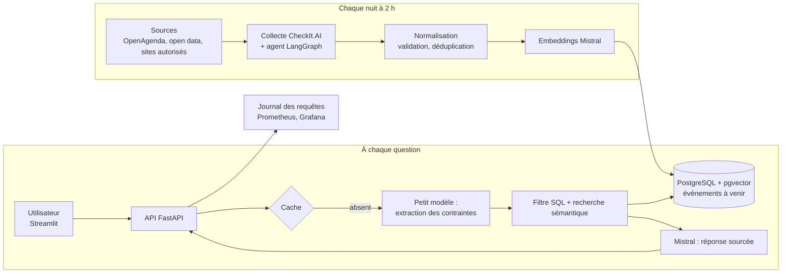

# Architecture

La collecte tourne chaque nuit ; la recherche répond en direct. Les deux partagent
une même base PostgreSQL avec l'extension pgvector.

## Étapes d'une question

1. **Cache** : une question déjà posée le même jour, sur la même version de l'index, est servie sans appel au LLM.
2. **Extraction des contraintes** : un petit modèle Mistral transforme la question en JSON (date, quartier, budget, type), validé par Pydantic.
3. **Filtre SQL** : on ne garde que les événements qui respectent ces contraintes.
4. **Recherche sémantique** : pgvector classe les candidats restants par proximité avec la question.
5. **Génération** : Mistral rédige une réponse courte, avec le lien source de chaque événement.
6. **Journalisation** : question, contraintes, événements renvoyés, latence, tokens et coût.

## Où est le code

| Étape | Dossier |
| --- | --- |
| Collecte, normalisation, stockage | `src/`, `config/`, `dags/` |
| API, filtres, recherche, génération | `app/` |
| Interface | `dashboard/` |
| Agent de collecte | `agent/` (conception), `reference/p13_agent/` (code à reprendre) |
| Monitoring | `monitoring/`, `reference/p5_monitoring/`, `reference/p14_observabilite/` |
