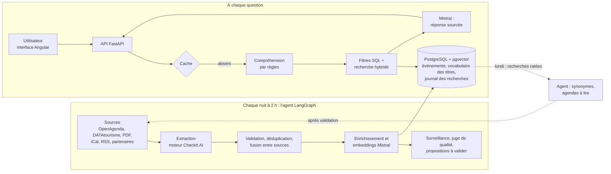

# Architecture

La collecte tourne chaque nuit ; la recherche répond en direct. Les deux
partagent une même base PostgreSQL avec l'extension pgvector. Une boucle les
relie : ce que les gens cherchent sans trouver revient chaque lundi à l'agent.

## Étapes d'une question

1. **Cache** : la même demande le même jour, sur la même collecte, est servie sans appel à Mistral.
2. **Compréhension** (`app/query_understanding.py`, par règles, sans LLM) : quand, où, pour qui, gratuit ou budget, intérieur ou plein air, type de sortie et mots-clés ; les cases cochées s'y ajoutent ; une relance (« et pour les enfants ? ») complète la question précédente ; les synonymes appris (`config/synonymes.yaml`) sont ajoutés.
3. **Filtres SQL stricts** : période, lieu, public, gratuit ou budget, cadre.
4. **Recherche hybride** : par le sens (pgvector) et par les mots (plein texte français), fusionnées par rang (RRF) ; ce qui répond exactement au type et aux mots demandés passe devant.
5. **Élargissement au sujet** : si rien ne parle du sujet (« cirque »), il est cherché sans les cases, puis sur 3 mois, puis partout, et la réponse dit ce qui diffère ; jamais 8 idées sans rapport.
6. **Choix des cartes** : séances regroupées par événement, 2 au plus par lieu, 8 cartes ; offres partenaires qui répondent en tête.
7. **Rédaction** : Mistral écrit 2 à 4 phrases qui citent les événements [n] ; les cartes suivent l'ordre de la réponse.
8. **Journal** : question, contraintes comprises, propositions, latence, tokens, coût, et ce qui a manqué (`rag_requests`).

Le détail et les mesures sont dans [Interface](interface.md) ; la nuit, dans [Agent de collecte](agent.md).

## Où est le code

| Étape | Dossier |
| --- | --- |
| Extraction, normalisation, écriture en base | `src/`, `config/` |
| Agent de collecte et apprentissage | `agent/`, lancé par `dags/sortiria_nightly_dag.py` |
| Schéma de la base | `sql/sortiria/` |
| API, compréhension, recherche, rédaction, avis | `app/` |
| Interface | `frontend/` (Angular) |
| Évaluation de la recherche | `scripts/eval_recherche.py`, `config/eval_recherche.yaml`, `benchmarks/` |
| Monitoring | `monitoring/` (code d'origine à reprendre : `reference/p5_monitoring/`, `reference/p14_observabilite/`) |
