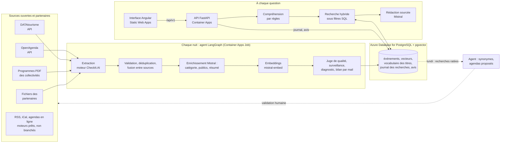
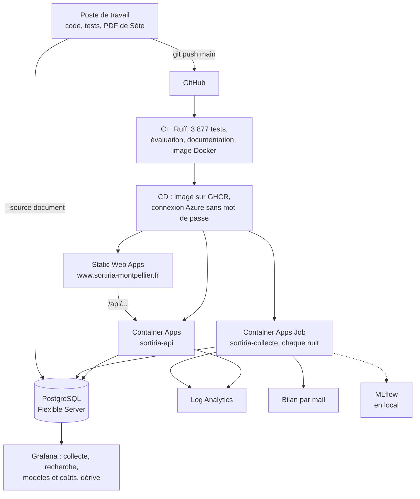

# Architecture

*Mise à jour le 27/10/2026.*

La collecte tourne chaque nuit ; la recherche répond en direct. Les deux
partagent une même base PostgreSQL avec l'extension pgvector. Une boucle les
relie : ce que les gens cherchent sans trouver revient chaque lundi à l'agent,
qui propose de quoi y répondre ; un humain valide.

## Vue d'ensemble

## Production et outillage

| Brique | Technologie | Pourquoi ce choix |
| --- | --- | --- |
| Collecte | moteur multi-sources de CheckIt.AI (projet 12) | un moteur par type de source, un adaptateur et une configuration YAML par fournisseur : une source de plus = une configuration, pas un programme |
| Orchestration de la nuit | LangGraph (Chess Agent, projet 13) ; Airflow en local, Container Apps Job en production | décisions qui demandent un modèle de langage, état partagé, routage, trace ([Agent](agent.md)) |
| Base | PostgreSQL 16 + pgvector | une seule base pour les données, les vecteurs, le journal et les avis ; filtres SQL et recherche par le sens dans la même requête |
| Modèles | Mistral : `mistral-small` (enrichissement, rédaction), `mistral-medium` (juge de qualité de la nuit, secours de la rédaction), `mistral-large` (juge de pertinence, lancé à la main), `mistral-embed`, Mistral Moderation | hébergement européen, coût bas, un seul fournisseur |
| API | FastAPI, réponse diffusée (Server-Sent Events) | l'interface affiche les étapes de la recherche au fil de l'eau |
| Interface | Angular (Chess Agent) | écran unique : filtres, question, réponse sourcée, cartes, détail |
| Déploiement | Azure : Static Web Apps, Container Apps, PostgreSQL Flexible Server ; GHCR ; GitHub Actions | gratuit ou presque la première année, mise en veille sans visiteur ([Coûts](couts.md)) |
| Suivi | `rag_requests`, `collect_runs`, Grafana, MLflow (poste), mail, rapport de dérive (PSI), rapport Evidently mensuel | chaque nuit et chaque question sont tracées ; la dérive des questions, des réponses et de la collecte est mesurée chaque nuit, et chaque mois par Evidently |

## Étapes d'une question

1. **Limite de débit** : 12 recherches par minute et par visiteur, 1 000 par heure pour tout le service.
2. **Cache** : la même demande, le même jour, sur la même collecte, est servie sans appel à Mistral (0,1 s).
3. **Compréhension** (`app/query_understanding.py`, par règles, sans LLM, 1 ms) : quand, où, pour qui, gratuit ou budget, intérieur ou plein air, type de sortie et mots-clés ; les cases cochées s'y ajoutent ; une relance (« et pour les enfants ? ») complète la question précédente ; les synonymes appris (`config/synonymes.yaml`) sont ajoutés.
4. **Filtres SQL stricts** : période, lieu, public, gratuit ou budget, cadre.
5. **Recherche hybride** : par le sens (pgvector) et par les mots (plein texte français), fusionnées par rang (RRF) ; ce qui répond exactement au type et aux mots demandés passe devant.
6. **Élargissement au sujet** : si rien ne parle du sujet (« cirque »), ou s'il est nettement mieux montré sans les contraintes (« karaoké » avec « Famille » coché), il est cherché sans les cases, puis sur 3 mois, puis partout, et la réponse dit ce qui diffère ; jamais 8 idées sans rapport.
7. **Choix des cartes** : séances regroupées par événement, 2 au plus par lieu, 8 cartes ; offres partenaires qui répondent en tête.
8. **Rédaction** : Mistral écrit 2 à 4 phrases qui citent les événements [n] ; seules les citations d'événements fournis sont gardées.
9. **Journal** : question, contraintes comprises, propositions, latence, tokens, coût, ce qui a manqué (`rag_requests`) ; pouce haut / bas (`feedback`).

Temps mesurés par étape : [Évaluation](evaluation.md). Le détail de la
recherche : [Interface](interface.md) ; la nuit : [Agent de collecte](agent.md).

## Où est le code

| Étape | Dossier |
| --- | --- |
| Extraction, normalisation, écriture en base | `src/`, `config/` |
| Agent de collecte et apprentissage | `agent/`, lancé par `dags/sortiria_nightly_dag.py` (local) ou `python agent` (Azure) |
| Schéma de la base | `sql/sortiria/` |
| API, compréhension, recherche, rédaction, avis, limite de débit | `app/` |
| Interface | `frontend/` (Angular) |
| Évaluation et mesures | `scripts/eval_recherche.py`, `scripts/eval_pertinence.py`, `scripts/mesure_cout_latence.py`, `config/eval_*.yaml`, `benchmarks/` |
| Déploiement | `docker/Dockerfile.api`, `.github/workflows/`, `frontend/public/staticwebapp.config.json` |
| Monitoring | `monitoring/` (Grafana), `agent/tracking.py` (MLflow), `agent/drift.py` (dérive), `scripts/versionnage.py` (registres MLflow des consignes et de la chaîne) |

### Le dossier `app/`, un fichier par usage

Depuis le 23/10/2026, la recherche est découpée en modules ;
`search_service.py` ne garde que l'enchaînement.

| Fichier | Usage |
| --- | --- |
| `main.py`, `interface_api.py`, `ratings_api.py` | l'application FastAPI et ses routes (`/api/v1`, notes des clients) |
| `security.py`, `config.py`, `rate_limit.py` | clé API, réglages, limite de débit |
| `query_understanding.py` | la compréhension de la question, par règles |
| `search_service.py` | l'enchaînement des 4 étapes : `plan_search`, `run_search`, `SearchServices`, `SearchResult`, flux SSE |
| `search_filters.py` | les cases cochées (`SearchFilters`, valeurs permises, libellés, `period_bounds`) |
| `search_query.py` | la requête SQL : filtres, classement par le sens et par les mots, élargissement au sujet, partenaires en tête, vecteur de la question |
| `search_cards.py` | les cartes (dates, prix, lieux, séances regroupées), offres partenaires, « À ne pas manquer », sources |
| `search_detail.py` | la fiche d'un événement, les avis sur son lieu, « Vos sorties à noter » |
| `search_answer.py` | la rédaction par Mistral (`WRITE_PROMPT`, `PROMPT_VERSION`) et la réponse de repli |
| `search_cache.py` | le cache des réponses (`cache_key`, lecture, écriture, `index_version`) |
| `search_log.py` | le journal `rag_requests`, le coût, les pouces, la santé de la base et de la collecte |

Chaque fonction a une docstring numpy ; la [Référence du code](reference/index.md)
a une page par fichier Python.
