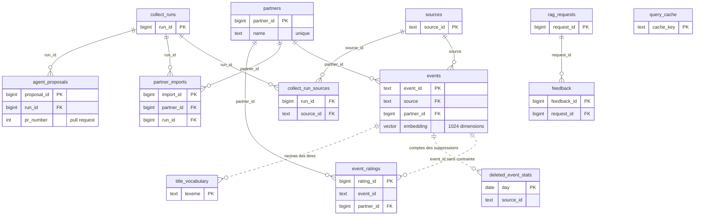

# Base de données

SortirIA utilise **PostgreSQL 16 avec l'extension pgvector** : les filtres
stricts (date, zone, budget, public) et la recherche sémantique se font dans la
même base, et souvent dans la même requête.

Tout est rangé dans **un seul schéma, `sortiria`** : **13 tables** et
**6 vues**. La base sert trois lecteurs :

- l'**agent de collecte**, qui l'écrit chaque nuit (`agent/`, avec
  `src/event/event_repository.py`) ;
- la **recherche de l'interface**, qui lit les événements proposables et trace
  chaque question (`app/search_service.py`) ;
- **Grafana**, qui lit les tables de suivi (`monitoring/grafana/`).

Cette page est la référence du schéma : chaque table, chaque colonne utile,
chaque lien et la raison de chaque choix. Le SQL fait foi : en cas de doute,
lire les fichiers de `sql/sortiria/`.

## Les fichiers et leur histoire

Le schéma est dans `sql/sortiria/`, en fichiers numérotés exécutés dans l'ordre.

| Fichier | Contenu |
| --- | --- |
| `00_extensions.sql` | extension `vector`, schéma `sortiria`, fonctions `distance_km`, `normalize_city`, `event_zone` |
| `01_sources.sql` | tables `sources`, `partners`, `partner_imports` ; sources déclarées au départ |
| `02_events.sql` | table `events`, ses contraintes et ses index |
| `03_collect.sql` | tables `collect_runs`, `collect_run_sources`, `agent_proposals`, `deleted_event_stats` ; colonne `partner_imports.run_id` |
| `04_rag.sql` | tables `rag_requests`, `feedback`, `query_cache`, `event_ratings` |
| `05_views.sql` | les 6 vues |
| `06_retention.sql` | fonction `purge_old_data` |
| `07_vocabulary.sql` | table `title_vocabulary`, fonctions `title_lexemes` et `refresh_title_vocabulary` |

Il a été écrit pour SortirIA le 13/10/2026 (`events`, `collect_runs`,
`rag_requests`), complété le 14/10/2026 (sources, partenaires, avis, cache,
publics, vues, notes des clients, statistiques des suppressions), puis le
15/10/2026 (statut `partiel`, réponse rédigée gardée, vocabulaire des titres).
Les anciens fichiers de CheckIt.AI, qui décrivaient des articles de presse
étiquetés, sont rangés dans `reference/sql_checkit/`.

## Créer ou mettre à jour la base

```bash
docker compose up -d db                      # base vide : le schéma est créé tout seul
uv run python -m scripts.init_db             # base existante : mise à jour
uv run python -m scripts.init_db --verifier  # liste les tables et vues
```

Les fichiers sont réexécutables : relancer `init_db` après une modification du
schéma conserve les données.

- Au premier démarrage d'une base vide, docker compose exécute les fichiers
  (ils sont montés dans `/docker-entrypoint-initdb.d`).
- `scripts/init_db.py` exécute les fichiers `sql/sortiria/[0-9][0-9]_*.sql`
  dans l'ordre, en autocommit : chaque fichier a sa propre transaction
  (`BEGIN … COMMIT`), une erreur n'annule que le fichier en cours. Il attend
  jusqu'à 90 secondes que la base soit prête (juste après `docker compose up`,
  PostgreSQL redémarre une fois).
- `--verifier` compare ce qui existe aux listes `EXPECTED_TABLES` (les
  13 tables) et `EXPECTED_VIEWS` (les 6 vues) et signale ce qui manque
  (`MANQUANT : …`, code de sortie 1).

## Schéma d'ensemble



Les traits pleins sont des clés étrangères. Les pointillés sont des liens
**volontairement sans clé étrangère** : les notes des clients
(`event_ratings`) et les statistiques de suppression (`deleted_event_stats`)
doivent survivre à la suppression de l'événement ; `title_vocabulary` est
recalculée à partir des titres. `feedback.event_id` ne référence pas non plus
`events`, pour la même raison. `query_cache` est indépendante (son lien avec
les collectes passe par `index_version`).

| Famille | Tables | Écrite par | Lue par |
| --- | --- | --- | --- |
| Fournisseurs | `sources`, `partners`, `partner_imports` | `01_sources.sql` (sources), l'agent (partenaires et imports, d'après `config/sources.yaml` et les fichiers reçus) | l'interface (attribution), Grafana |
| Événements | `events` | l'agent | la recherche (par la vue `v_upcoming_events`), Grafana |
| Collecte | `collect_runs`, `collect_run_sources`, `agent_proposals`, `deleted_event_stats` | l'agent | Grafana, `agent.proposals`, le mail de la nuit |
| Recherche | `rag_requests`, `feedback`, `query_cache`, `title_vocabulary` | l'API de l'interface, l'agent (vocabulaire) | la recherche, l'agent (bilan), Grafana |
| Notes des clients | `event_ratings` | l'API des notes, l'interface | la recherche, l'agent, Grafana |

## Les règles communes

| Règle | Où elle vit | Pourquoi |
| --- | --- | --- |
| Toutes les dates sont des `TIMESTAMPTZ` ; les comparaisons « jour » passent par `AT TIME ZONE 'Europe/Paris'` | vues, `delete_past_events`, `deleted_event_stats.day` | un événement « ce soir » ne doit pas disparaître à minuit UTC |
| `time_known` distingue une heure réelle d'une date seule (minuit) | `events`, vues | un événement sans heure reste visible toute sa journée |
| On ne lit et ne propose que les 3 prochains mois (`days_forward: 90`, vue `v_upcoming_events`) | configuration, vue | la promesse est « que faire bientôt » |
| Un événement passé reste 7 jours puis est supprimé ; il n'est jamais proposé entre-temps | `delete_past_events`, vue, `event_ratings` | le client peut noter après avoir vécu la sortie |
| Plafond de 10 000 événements, les plus lointains partent d'abord | `enforce_event_cap` | taille et coût bornés |
| Une suppression laisse une statistique, jamais la fiche | `deleted_event_stats`, écrite dans la même requête que le `DELETE` | savoir ce qui part et pourquoi, sans archive |
| Les clients sont anonymes : empreinte SHA-256 salée de leur session, ni nom ni courriel | `event_ratings.user_key`, `RATING_SALT` | RGPD, minimisation |
| Les coordonnées des personnes chez les partenaires ne sont pas en base | `partners` | RGPD |
| Les contraintes `CHECK` ferment les vocabulaires (statut, présence, publics, secteur, motif, note) | toutes les tables | une valeur hors liste est une erreur de code, pas une nouvelle catégorie |
| Les textes sont `NOT NULL DEFAULT ''` plutôt que `NULL` ; `NULL` est réservé à « pas encore calculé » (`embedding`, `enriched_at`, `quality_score`, `events_total`) | toutes les tables | une seule façon d'écrire « vide » dans le code et les requêtes |
| Identifiants : texte stable quand il a un sens (`source_id`, `event_id`, `cache_key`, `lexeme`), `BIGSERIAL` sinon | toutes les tables | un `event_id` se recalcule d'une nuit à l'autre, ce qui rend l'upsert possible |
| Les scripts sont réexécutables (`IF NOT EXISTS`, `ADD COLUMN IF NOT EXISTS`, contraintes supprimées puis recréées, vues recréées, `CREATE OR REPLACE FUNCTION`) | `sql/sortiria/*.sql`, `scripts/init_db.py` | mettre à niveau une base existante sans la refaire |
| Un seul schéma `sortiria`, une seule base, les vecteurs dans la table des événements | `events.embedding` (pgvector, index HNSW) | un filtre SQL et une distance cosinus dans la même requête |

Ces règles sont des contraintes PostgreSQL ou des requêtes SQL uniques : même
un bug dans le code Python ne peut pas les contourner. Par exemple :

- un événement mis en avant (`is_sponsored`) a forcément un partenaire ;
- les publics possibles sont `famille`, `soiree`, `ados` et `seniors` ; l'âge
  minimal ne dépasse pas l'âge maximal ; la fin ne précède pas le début ;
- un avis vaut `-1` ou `1`, une seule fois par réponse ou par proposition ;
- une note vaut de 1 à 5 étoiles, une seule fois par client et par événement.

## Les fournisseurs : `sources`, `partners`, `partner_imports`

### `sources`

Une ligne par famille de source, insérée par `01_sources.sql`
(`ON CONFLICT DO NOTHING` : une ligne ajustée à la main n'est pas écrasée).
Elle porte ce que l'interface doit afficher sous chaque proposition et ce que la
loi demande. Un événement d'une source non déclarée est refusé (clé étrangère
dans `events`) : aucune donnée sans licence connue.

| Colonne | Type | Rôle, contrainte |
| --- | --- | --- |
| `source_id` | `TEXT`, clé primaire | identifiant stable : `openagenda`, `datatourisme`, `partenaire`, `ical`, `document`, `rss`, `scraper` ; c'est la valeur de `events.source` et de `collect_run_sources.source_id` |
| `name`, `homepage` | `TEXT` | affichage (`homepage` vide par défaut) |
| `kind` | `TEXT`, `CHECK` | `api`, `open_data`, `partenaire`, `page_web` : nature juridique de la source |
| `licence` | `TEXT` | Licence Ouverte 2.0, accord de partenariat, accord du lieu, réutilisation des informations publiques (CRPA), flux publié pour la syndication, autorisation de l'éditeur |
| `attribution` | `TEXT` | texte affiché sous la proposition (« Source : DATAtourisme ») ; la vue y ajoute le producteur et la date de mise à jour |
| `active` | `BOOLEAN`, vrai par défaut | une source désactivée disparaît de la vue des propositions sans supprimer ses événements |
| `created_at` | `TIMESTAMPTZ` | date de déclaration |

Les sources déclarées au départ :

| `source_id` | Nom | Nature | Licence |
| --- | --- | --- | --- |
| `openagenda` | OpenAgenda | `api` | Licence Ouverte 2.0 |
| `datatourisme` | DATAtourisme | `open_data` | Licence Ouverte 2.0 |
| `partenaire` | Partenaires SortirIA | `partenaire` | Accord de partenariat |
| `ical` | Calendriers des lieux partenaires | `partenaire` | Accord du lieu (le lieu est cité dans `events.source_credit`) |
| `document` | Programmes publiés par les collectivités (PDF lus par Mistral) | `open_data` | Réutilisation des informations publiques (CRPA, art. L321-1 et suivants) |
| `rss` | Flux RSS d'agenda | `page_web` | Flux publié pour la syndication |
| `scraper` | Agendas en ligne (avec autorisation écrite, robots.txt respecté) | `page_web` | Autorisation de l'éditeur |

- **Écrite par** : `01_sources.sql` seulement.
- **Lue par** : la vue `v_upcoming_events` (nom et attribution), la fiche
  détaillée et la liste des sources de l'interface (`app/search_service.py`).
- **Conservation** : permanente.

### `partners`

Les organisations partenaires (ludothèque, bar, festival…), créées ou mises à
jour par l'agent d'après `config/sources.yaml` quand leur fichier est lu. Seule
l'organisation est en base ; les coordonnées des personnes restent hors de la
base (RGPD).

| Colonne | Type | Rôle, contrainte |
| --- | --- | --- |
| `partner_id` | `BIGSERIAL`, clé primaire | référencé par `events`, `partner_imports`, `event_ratings` |
| `name` | `TEXT`, `UNIQUE` | la clé de fusion avec la configuration |
| `sector` | `TEXT`, `CHECK` | `animation`, `soiree`, `enfants`, `culture`, `sport`, `autre` (par défaut) : statistiques et prospection |
| `website` | `TEXT` | lien par défaut des événements du partenaire s'ils n'en ont pas |
| `status` | `TEXT`, `CHECK` | `prospect` (par défaut), `actif`, `termine` : état de la relation |
| `sponsored_until` | `DATE` | jusqu'à quand sa formule payante court (`events.is_sponsored`) |
| `formula` | `TEXT`, `CHECK` | `gratuit` (par défaut), `mis_en_avant`, `premium` (17/10/2026) : classe les offres partenaires entre elles, jamais devant un événement qui répond mieux ([Partenaires](partenaires.md)) |
| `notes` | `TEXT` | suivi interne, gardé même si la configuration change |
| `created_at` | `TIMESTAMPTZ` | création |

- **Écrite par** : `attach_partners` (`src/event/event_repository.py`), appelée
  par l'agent avant l'upsert des événements, dans la même transaction.
- **Lue par** : la vue `v_partner_ratings`, la rubrique « À ne pas manquer » et
  l'ordre des offres partenaires (`partner_rank` : 2 premium, 1 mis en avant,
  0 sinon, dans `app/search_service.py`), Grafana.
- **Conservation** : permanente.

### `partner_imports`

Un fichier reçu d'un partenaire (tableur, CSV, programme) = une ligne, avec son
bilan.

| Colonne | Type | Rôle, contrainte |
| --- | --- | --- |
| `import_id` | `BIGSERIAL`, clé primaire | |
| `partner_id` | `BIGINT` → `partners`, obligatoire | quel partenaire |
| `run_id` | `BIGINT` → `collect_runs`, facultatif | quelle nuit de collecte l'a traité (colonne ajoutée par `03_collect.sql`) ; remis à `NULL` quand la collecte est purgée |
| `file_name`, `file_sha256`, `received_at` | `TEXT`, `TEXT`, `TIMESTAMPTZ` | traçabilité du fichier ; le nom seul ne suffit pas, un partenaire renvoie souvent le même nom |
| `status` | `TEXT`, `CHECK` | `recu` (par défaut), `importe`, `partiel`, `refuse` : résultat de la lecture |
| `rows_total`, `rows_loaded`, `rows_rejected` | `INTEGER` | ce qu'on répond au partenaire : « 5 lignes gardées, 2 refusées » |
| `rejection_reasons` | `JSONB` | motifs des refus : « date illisible, heure illisible » |

Contrainte `partner_imports_once UNIQUE (partner_id, file_sha256)` :
l'empreinte SHA-256 empêche d'importer deux fois le même fichier.

- **Écrite par** : `attach_partners` (`src/event/event_repository.py`).
- **Lue par** : Grafana, le bilan de la nuit.
- **Conservation** : permanente ; la purge des collectes ne fait que détacher
  `run_id`.

## La table centrale : `events`

Une ligne par **événement unique** (une séance, ou une exposition qui dure),
après déduplication entre sources, quelle que soit sa source. À titre
d'ordre de grandeur, la base comptait **≈ 2 450 événements** au 16/10/2026.

- **Écrite par** : `upsert_events` (insertion ou mise à jour sur `event_id`),
  `update_enrichments`, `update_embeddings` et les suppressions
  (`delete_past_events`, `delete_unseen_events`, `enforce_event_cap`), toutes
  dans `src/event/event_repository.py`, appelées par l'agent (`agent/nodes.py`).
- **Lue par** : la vue `v_upcoming_events` (la recherche et l'interface) ; la
  table directement seulement pour la fiche d'un événement passé encore notable,
  « Vos sorties à noter », la notation et le vocabulaire des titres
  (`app/search_service.py`, `src/event/event_repository.py`).
- **Conservation** : tant que la source le renvoie, dans la limite des 3 mois
  et du plafond ; 7 jours après sa fin.

### Identité et provenance

| Colonne | Type | Rôle, contrainte |
| --- | --- | --- |
| `event_id` | `TEXT`, clé primaire | empreinte de titre + jour + heure + lieu normalisés (voir [Identifiant d'un événement](#identifiant-dun-evenement)) |
| `source` | `TEXT` → `sources`, obligatoire | la source qui l'a fourni en dernier (contrainte `events_source_fkey`) |
| `source_event_id` | `TEXT` | l'identifiant chez la source (uid OpenAgenda, uuid@jour DATAtourisme, source@page@jour@id pour un PDF) : pour retrouver l'origine |
| `first_seen_at`, `last_seen_at` | `TIMESTAMPTZ` | première et dernière nuit où la source l'a renvoyé ; `last_seen_at` sert au retrait des disparus |
| `extracted_at` | `TIMESTAMPTZ` | moment de l'extraction |
| `source_credit`, `source_updated_at` | `TEXT`, `DATE` | producteur de la fiche (office de tourisme, lieu, document) et date de sa mise à jour : à citer d'après la Licence Ouverte |

### Contenu

| Colonne | Type | Rôle, contrainte |
| --- | --- | --- |
| `title` | `TEXT`, obligatoire | ce que lit l'utilisateur |
| `description` | `TEXT` | limitée par les mappers (500 à 1 200 caractères) |
| `category`, `keywords` | `TEXT`, `TEXT[]` | la catégorie et les mots-clés tels que la source les donne (vocabulaires différents d'une source à l'autre) |
| `language` | `TEXT` | `fr` par défaut |
| `url` | `TEXT`, obligatoire | le lien vers la source ou l'organisateur : chaque proposition renvoie quelque part |
| `image_url` | `TEXT` | une image |

### Quand

| Colonne | Type | Rôle, contrainte |
| --- | --- | --- |
| `start_at` | `TIMESTAMPTZ`, obligatoire | début |
| `end_at` | `TIMESTAMPTZ` | fin facultative ; `events_end_after_start` : `end_at >= start_at` ; un événement de plusieurs jours finit à la fin de son dernier jour |
| `time_known` | `BOOLEAN`, vrai par défaut | vrai si l'heure est réelle ; faux pour une date seule : la vue et le retrait des passés regardent alors la journée entière |

### Où

| Colonne | Type | Rôle, contrainte |
| --- | --- | --- |
| `venue_name`, `address`, `city`, `postal_code` | `TEXT` | le lieu ; au moins un lieu ou une commune est exigé par la validation Python |
| `latitude`, `longitude` | `DOUBLE PRECISION` | pour la zone par distance quand la commune ne suffit pas (`sortiria.event_zone`) |

### Combien, pour qui

| Colonne | Type | Rôle, contrainte |
| --- | --- | --- |
| `price_text` | `TEXT` | le prix tel qu'écrit |
| `price_min`, `price_max` | `NUMERIC(8, 2)` | sa lecture ; `events_price_order` : `price_min <= price_max` |
| `is_free` | `BOOLEAN` | gratuit ; `NULL` si inconnu |
| `status` | `TEXT`, `CHECK` | `programme` (par défaut), `reprogramme`, `deplace_en_ligne`, `reporte`, `complet`, `annule` (statuts OpenAgenda 1 à 6) ; la vue exclut annulé, reporté et déplacé en ligne |
| `attendance` | `TEXT`, `CHECK` | `sur_place` (par défaut), `en_ligne`, `mixte` ; la vue exclut `en_ligne` : une sortie a lieu quelque part |
| `age_min`, `age_max` | `SMALLINT` | les âges annoncés ; `events_age_check` : entre 0 et 120, et `age_min <= age_max` |
| `audiences` | `TEXT[]` | les publics ; `events_audiences_check` : sous-ensemble de `famille`, `soiree`, `ados`, `seniors` (`ados` et `seniors` viennent de l'enrichissement Mistral) ; `audiences` = règles de la source ∪ Mistral |
| `accessibility` | `TEXT[]` | mentions d'accessibilité (OpenAgenda) |
| `partner_id` | `BIGINT` → `partners` | événement d'un partenaire |
| `is_sponsored` | `BOOLEAN`, faux par défaut | mis en avant jusqu'à `sponsored_until` ; `events_sponsored_needs_partner` : pas de mise en avant sans partenaire |

### Enrichissement Mistral (14/10/2026)

Remplies par `src/event/event_enrichment.py`. Vides tant que l'événement n'est
pas enrichi, ou après une modification du titre ou de la description.

| Colonne | Type | Rôle, contrainte |
| --- | --- | --- |
| `category_norm` | `TEXT` | catégorie unifiée parmi 18 valeurs (concert, atelier, exposition…) : le filtre et l'affichage de l'interface ; vide = pas encore classé, la recherche retombe alors sur `category` |
| `summary` | `TEXT` | résumé d'une phrase tiré du texte : la carte de l'interface et le texte vectorisé |
| `price_band` | `TEXT` | `gratuit`, `moins_10`, `10_25`, `plus_25`, `inconnu` (par défaut) : tranche calculée sans modèle (pas de contrainte `CHECK`) |
| `audiences_llm` | `TEXT[]` | les publics vus par Mistral, gardés à part pour que l'upsert de la nuit suivante ne les efface pas |
| `is_outing` | `BOOLEAN`, vrai par défaut | faux : signalé comme « pas une sortie » (offre d'emploi…), exclu de la recherche et du vocabulaire, jamais supprimé seul |
| `enriched_at`, `enrichment_version` | `TIMESTAMPTZ`, `TEXT` | remis à zéro si le texte change ou si la consigne change de version : l'événement repasse par Mistral |

### Recherche sémantique et plein texte

| Colonne | Type | Rôle, contrainte |
| --- | --- | --- |
| `embedding` | `vector(1024)` | vecteur `mistral-embed` du texte (titre, catégorie unifiée, résumé, lieu, commune, description) ; `NULL` tant qu'il n'est pas calculé, remis à `NULL` dès que le texte ou l'enrichissement change |
| `embedding_model` | `TEXT` | le modèle qui l'a calculé : un changement de modèle oblige à tout recalculer |

La recherche plein texte n'a pas de colonne ni d'index : le document
(`LEXICAL_DOCUMENT` dans `app/search_service.py` : titre compté deux fois,
résumé, catégories, lieu, commune et début de la description, sans accents,
dictionnaire `french`) est calculé à la volée sur les candidats.

### Index de `events`

| Index | Colonnes | Pour |
| --- | --- | --- |
| `events_pkey` | `event_id` | l'upsert |
| `events_start_at_idx` | `start_at` | les périodes, le retrait des passés, le plafond |
| `events_city_idx` | `lower(city)` | le filtre par commune |
| `events_category_idx` | `lower(category)` | le filtre par catégorie |
| `events_is_free_idx` | `is_free` | le filtre « gratuit » |
| `events_audiences_idx` | `audiences` (GIN) | les filtres de public |
| `events_partner_idx` | `partner_id`, partiel (`WHERE partner_id IS NOT NULL`) | les offres partenaires |
| `events_embedding_idx` | `embedding` (HNSW, `vector_cosine_ops`) | la recherche par similarité cosinus |

## Ce que l'agent laisse : `collect_runs`, `collect_run_sources`, `agent_proposals`, `deleted_event_stats`

### `collect_runs`

Une ligne par nuit de collecte, écrite par le nœud `report` (`write_report`
dans `agent/nodes.py`, puis `record_collect_run`). C'est la mémoire de l'agent
et la matière première de Grafana.

| Colonne | Type | Rôle, contrainte |
| --- | --- | --- |
| `run_id` | `BIGSERIAL`, clé primaire | référencé par les sources de la nuit, les imports partenaires, les propositions ; cité dans le mail ; le plus grand sert de `index_version` au cache des réponses |
| `started_at`, `finished_at` | `TIMESTAMPTZ` | durée de la nuit ; « heures depuis la dernière collecte réussie » en découle |
| `status` | `TEXT` | `running` par défaut, puis `success`, `partial_success` ou `failed` (valeurs de `agent/state.py`, sans contrainte `CHECK`) |
| `events_extracted`, `events_rejected`, `duplicates_merged` | `INTEGER` | le bilan de la préparation |
| `rejection_reasons` | `JSONB` | pourquoi les événements ont été refusés |
| `events_upserted` | `INTEGER` | ce qui est entré ou a été mis à jour |
| `events_expired`, `events_removed`, `events_capped` | `INTEGER` | ce qui est parti : passé, disparu de sa source, plafond |
| `events_total` | `INTEGER` | taille de la base après la collecte |
| `events_embedded`, `cost_usd`, `llm_usage` | `INTEGER`, `NUMERIC(10, 4)`, `JSONB` | le travail Mistral de la nuit : vecteurs calculés, coût estimé, tokens par modèle (`{modèle: {input, output}}`) |
| `coverage` | `JSONB` | sorties famille / soirée par zone sur 7 jours (`{zone: {famille, soiree}}`) : la promesse du service, nuit après nuit |
| `node_durations` | `JSONB` | secondes par nœud du graphe : où passe le temps |
| `quality_score`, `quality` | `NUMERIC(4, 3)`, `JSONB` | le juge Mistral : score de 0 à 1 (`NULL` sans contrôle) et problèmes relevés |
| `alerts`, `failed_sources`, `message` | `TEXT[]`, `TEXT[]`, `TEXT` | ce que le mail a dit |
| `prompt_version`, `mlflow_run_id` | `TEXT` | la consigne de lecture des PDF et le lien vers l'exécution MLflow : on peut relier une baisse de qualité à un changement de consigne |

Index : `collect_runs_started_at_idx` (`started_at`), pour Grafana.

- **Lue par** : `v_collect_health` (Grafana), `index_version`
  (`app/search_service.py`).
- **Conservation** : 1 an (`purge_old_data`).

### `collect_run_sources`

Une ligne par source et par nuit, clé primaire `(run_id, source_id)`. C'est ce
qui montre les décisions de l'agent.

| Colonne | Type | Rôle, contrainte |
| --- | --- | --- |
| `run_id` | `BIGINT` → `collect_runs`, `ON DELETE CASCADE` | la nuit ; le détail part avec elle |
| `source_id` | `TEXT` → `sources` | la source |
| `status` | `TEXT`, `CHECK` | `ok`, `partiel`, `echec` ; `partiel` (15/10/2026) = des événements mais une lecture incomplète, jamais balayée ni prise pour référence |
| `attempts` | `SMALLINT` | combien d'essais il a fallu |
| `events_kept` | `INTEGER` | événements retenus après validation et déduplication : la référence de la détection de baisse (meilleur des 7 dernières nuits `ok`) |
| `duration_ms`, `error` | `INTEGER`, `TEXT` | diagnostic |

- **Écrite par** : `record_run_sources` (`src/event/event_repository.py`),
  depuis `write_report` (`agent/nodes.py`).
- **Lue par** : `fetch_previous_source_counts` (détection de baisse), Grafana.
- **Conservation** : 1 an, avec sa collecte.

### `agent_proposals`

Les réparations que l'agent **propose sans les appliquer** (document déplacé :
nouvelle adresse trouvée et vérifiée ; nouvel agenda OpenAgenda trouvé). Un
humain les accepte ou les refuse : sur GitHub, par la pull request que l'agent
ouvre pour chacune (16/10/2026, `agent/pull_requests.py`), ou en ligne de
commande (`uv run python -m agent.proposals`).

| Colonne | Type | Rôle, contrainte |
| --- | --- | --- |
| `proposal_id` | `BIGSERIAL`, clé primaire | le numéro passé à `--accepter N` |
| `created_at` | `TIMESTAMPTZ` | |
| `run_id` | `BIGINT` → `collect_runs`, `ON DELETE SET NULL` | la nuit qui l'a proposée ; la proposition survit à la purge de la collecte |
| `source_id` | `TEXT` | quelle source (pas de clé étrangère) |
| `kind` | `TEXT` | famille de panne d'après `agent/diagnosis.py` (`document_deplace`, `acces_refuse`, `quota`, `reseau`, `format_inattendu`, `inconnue`) ou `nouvel_agenda` ; sans contrainte `CHECK` |
| `diagnosis` | `TEXT` | l'explication lisible |
| `action` | `JSONB` | ce qu'il faudrait faire : `{"type": "remplacer_url", "old": …, "new": …}` ou `{"type": "ajouter_agenda", "new": …, "events": …}` |
| `status` | `TEXT`, `CHECK` | `en_attente` (par défaut), `acceptee`, `refusee`, `appliquee` |
| `decided_at` | `TIMESTAMPTZ` | la décision humaine (pour une PR : l'heure du merge ou de la fermeture) |
| `pr_number`, `pr_url` | `INTEGER`, `TEXT` | la pull request ouverte par l'agent (16/10/2026) ; vide sans jeton GitHub |
| `decided_by` | `TEXT` | `github` (merge ou fermeture de la PR) ou `ligne de commande` |

Index unique partiel `agent_proposals_pending_once` sur
`(source_id, action ->> 'new') WHERE status = 'en_attente'` : la même
réparation n'est proposée qu'une fois tant qu'elle attend. Une réparation
refusée n'est plus jamais reproposée (règle de la requête d'insertion,
`INSERT_PROPOSAL_SQL`).

- **Écrite par** : `record_proposals`, `set_proposal_status`
  (`src/event/event_repository.py`), depuis `agent/nodes.py` et
  `agent/proposals.py`.
- **Lue par** : `agent.proposals`, Grafana.
- **Conservation** : permanente.

### `deleted_event_stats`

Les suppressions **comptées**, jamais les fiches. Écrite dans la même requête
SQL que le `DELETE` (CTE `DELETE_WITH_STATS_SQL`), donc toujours cohérente.
Clé primaire `(day, source_id, reason, category, zone)` : une nouvelle
suppression du même jour ajoute ses comptes (`ON CONFLICT … DO UPDATE`).

| Colonne | Type | Rôle, contrainte |
| --- | --- | --- |
| `day` | `DATE` | jour de la suppression (heure de Paris) |
| `source_id` | `TEXT` | la source (pas de clé étrangère) |
| `reason` | `TEXT`, `CHECK` | `passe`, `disparu`, `plafond` ; une montée des `disparu` signale une source qui se vide |
| `category` | `TEXT` | catégorie unifiée, `non_classe` sinon |
| `zone` | `TEXT` | `sortiria.event_zone` de l'événement |
| `events`, `family`, `night` | `INTEGER` | combien, dont publics famille et soirée : pour mesurer ce que la base a proposé puis perdu |

- **Écrite par** : `delete_past_events`, `delete_unseen_events`,
  `enforce_event_cap` (`src/event/event_repository.py`).
- **Lue par** : Grafana (tableau « Collecte »).
- **Conservation** : sans limite (quelques lignes par jour).

## La recherche et son suivi : `rag_requests`, `feedback`, `query_cache`, `title_vocabulary`

### `rag_requests`

Une ligne par recherche de l'interface. C'est le journal du RAG : ce qu'on a
demandé, ce qu'on a répondu, ce que ça a coûté. Il sert à rejouer le jeu de
test, à faire juger les réponses, au bilan des recherches de l'agent et à
Grafana. Aucune donnée personnelle (RGPD) : pas de compte, pas d'adresse IP.

| Colonne | Type | Rôle, contrainte |
| --- | --- | --- |
| `request_id` | `BIGSERIAL`, clé primaire | référencé par `feedback` ; renvoyé à l'interface pour le pouce |
| `asked_at` | `TIMESTAMPTZ` | moment de la question |
| `session_id` | `UUID` | identifiant tiré au hasard par l'interface, facultatif (l'interface actuelle n'en envoie pas) |
| `question` | `TEXT`, obligatoire | la question |
| `constraints` | `JSONB` | cases cochées et contraintes comprises (`app/query_understanding.py`) ; clé `recherche` (15/10/2026) : réponse exacte ou non, mots inconnus de la base, sujet introuvable |
| `event_ids` | `TEXT[]` | les événements proposés : pour vérifier après coup que la réponse ne citait que des événements réels |
| `answer` | `TEXT` (15/10/2026) | la réponse rédigée, gardée pour rejouer le jeu de test, la faire juger par Mistral et comparer deux consignes |
| `degraded` | `BOOLEAN` (15/10/2026) | réponse simplifiée produite sans Mistral (service indisponible) |
| `from_cache` | `BOOLEAN` | servie depuis `query_cache` |
| `status` | `TEXT`, `CHECK` | `ok` (par défaut), `aucun_resultat`, `refuse`, `erreur` |
| `error` | `TEXT` | le message d'erreur |
| `latency_ms`, `prompt_tokens`, `completion_tokens` | `INTEGER` | performance |
| `cost_usd` | `NUMERIC(10, 6)` | coût Mistral, même unité que `collect_runs` (ancien `cost_eur`, renommé le 15/10/2026) |
| `llm_model`, `prompt_version` | `TEXT` | le modèle et la consigne en jeu : indispensables pour comparer deux consignes ou deux modèles |
| `extraction_model`, `index_version` | `TEXT` | prévus pour le même usage, pas encore remplis par la recherche |

Index : `rag_requests_asked_at_idx` (`asked_at`), pour Grafana et la purge.

- **Écrite par** : `run_search` (`LOG_SQL`, `app/search_service.py`). Le script
  d'évaluation (`scripts/eval_recherche.py`) n'y écrit rien.
- **Lue par** : `v_daily_quality`, `fetch_search_gaps` (bilan hebdomadaire de
  l'agent : questions sans réponse exacte, mots inconnus), Grafana (tableau
  « Recherche »).
- **Conservation** : 90 jours (`purge_old_data`).

### `feedback`

Le pouce haut ou bas sur une **réponse de l'assistant** (« Oui, cette réponse
m'aide »). Différent de `event_ratings` : ici on juge la recommandation, là-bas
la sortie vécue.

| Colonne | Type | Rôle, contrainte |
| --- | --- | --- |
| `feedback_id` | `BIGSERIAL`, clé primaire | |
| `request_id` | `BIGINT` → `rag_requests`, `ON DELETE CASCADE` | la réponse jugée ; l'avis part avec elle |
| `event_id` | `TEXT`, vide par défaut | vide = avis sur la réponse entière ; sinon un événement proposé (pas de clé étrangère : l'avis reste après la suppression de l'événement) |
| `rating` | `SMALLINT`, `CHECK` | `-1` ou `1` |
| `comment` | `TEXT`, `CHECK` | 500 caractères au plus (le code coupe à 300) ; jamais publié |
| `created_at` | `TIMESTAMPTZ` | |

Contrainte `feedback_once UNIQUE (request_id, event_id)` : un avis par réponse
et par événement.

Depuis le 16/10/2026, l'interface envoie l'avis sur la réponse entière
(`POST /api/v1/reponses/{request_id}/avis`, `record_feedback` dans
`app/search_service.py`) : seulement pour une réponse de moins d'un jour, et un
second clic remplace le premier.

- **Lue par** : `v_daily_quality`, Grafana (part des avis positifs).
- **Conservation** : 90 jours, avec sa question.

### `query_cache`

La même demande, le même jour, sur les mêmes données, est servie sans appeler
Mistral. Utilisé par la recherche de l'interface depuis le 15/10/2026.

| Colonne | Type | Rôle, contrainte |
| --- | --- | --- |
| `cache_key` | `TEXT`, clé primaire | empreinte SHA-256 de la version de la consigne, de `index_version`, du jour (heure de Paris), de la question et du contexte normalisés, des cases cochées et des synonymes appris (`cache_key` dans `app/search_service.py`) |
| `question_normalized`, `constraints` | `TEXT`, `JSONB` | la demande comprise |
| `response` | `JSONB`, obligatoire | la réponse complète et sourcée, rejouée telle quelle |
| `event_ids` | `TEXT[]` | les événements proposés |
| `index_version` | `TEXT` | numéro de la dernière collecte : une nouvelle nuit rend les anciennes entrées inutilisables |
| `hits` | `INTEGER` | nombre de fois où l'entrée a servi : l'utilité du cache |
| `created_at`, `expires_at` | `TIMESTAMPTZ` | fin de validité : 6 heures après, et jamais après minuit (heure de Paris) |

Index : `query_cache_expires_at_idx` (`expires_at`), pour la lecture et la
purge.

- **Écrite et lue par** : `read_cache` et `write_cache`
  (`app/search_service.py`) ; une erreur de cache ne bloque jamais la recherche.
- **Conservation** : jusqu'à `expires_at`, puis supprimée par la purge de la
  nuit.

### `title_vocabulary`

Les **sujets** que la base connaît (15/10/2026). Un mot de la question est un
sujet s'il apparaît dans au moins un titre d'événement (« cirque », « photo »,
« poterie ») : la recherche l'exige alors dans le texte des événements
proposés. Un mot absent de tous les titres (« romantique », « insolite ») est
une **ambiance** : la recherche par le sens s'en charge. Aucune liste écrite à
la main : le vocabulaire suit la base.

| Colonne | Type | Rôle, contrainte |
| --- | --- | --- |
| `lexeme` | `TEXT`, clé primaire | racine d'un mot des titres (lexème français, sans accents), 3 caractères au moins |
| `events` | `INTEGER` | nombre de titres où la racine apparaît |
| `refreshed_at` | `TIMESTAMPTZ` | dernier calcul |

Index : `title_vocabulary_prefix_idx` (`lexeme text_pattern_ops`), pour la
recherche par préfixe (« photo » trouve « photograph », racine de
« photographies »).

- **Écrite par** : `sortiria.refresh_title_vocabulary()`, appelée par l'agent
  après chaque collecte (`refresh_title_vocabulary` dans
  `src/event/event_repository.py`).
- **Lue par** : `known_subjects` (`app/search_service.py`) ; tant que la table
  est vide, les titres sont lus directement.
- **Conservation** : recalculée entièrement chaque nuit.

## Les notes des clients : `event_ratings`

Un client note un événement qu'il a vécu, de 1 à 5 étoiles, avec un court
commentaire facultatif (14/10/2026). À ne pas confondre avec `feedback`, le
pouce sur une réponse de l'assistant.

La table est volontairement **sans clé étrangère** vers `events` :
l'événement sera supprimé 7 jours après sa fin, la note reste. Elle copie donc
ce dont elle aura besoin plus tard.

| Colonne | Type | Rôle, contrainte |
| --- | --- | --- |
| `rating_id` | `BIGSERIAL`, clé primaire | une note modifiée garde son identifiant |
| `created_at`, `updated_at` | `TIMESTAMPTZ` | création et dernière modification |
| `event_id` | `TEXT`, obligatoire | l'événement noté (sans contrainte, voir ci-dessus) |
| `user_key` | `TEXT`, obligatoire | empreinte SHA-256 de `RATING_SALT` + identifiant de session : le même client garde la même empreinte, personne ne peut remonter à lui sans le sel, qui reste dans le `.env` |
| `stars` | `SMALLINT`, `CHECK` | de 1 à 5 |
| `comment` | `TEXT`, `CHECK` | 300 caractères au plus |
| `comment_status` | `TEXT`, `CHECK` | `aucun` (par défaut), `en_attente` (Mistral Moderation n'a pas répondu, l'agent reprend la nuit suivante), `publie`, `refuse` |
| `moderation` | `JSONB` | les catégories signalées par la modération (`flagged`) ; après une revue humaine (16/10/2026, `agent.commentaires`) : `revue_humaine` (décision, statut d'avant, date) |
| `source`, `title`, `venue_name`, `city`, `zone`, `category`, `event_start` | copies | ce qui donne du sens à la note après la suppression de l'événement : l'interface affiche « Super ambiance · Concert jazz, sam. 10 oct. » |
| `partner_id` | `BIGINT` → `partners`, `ON DELETE SET NULL` | la note survit aussi au partenaire |

Contraintes et index :

- `event_ratings_once UNIQUE (event_id, user_key)` : une note par client et par
  événement ; une nouvelle note remplace l'ancienne (`ON CONFLICT … DO UPDATE`) ;
- `event_ratings_venue_idx` (`city, venue_name`) pour les moyennes par lieu ;
- `event_ratings_partner_idx` (`partner_id`, partiel) ;
- `event_ratings_pending_idx` (`comment_status`, partiel sur `en_attente`) pour
  la reprise de modération.

| Règle | Comment |
| --- | --- |
| Après l'avoir vécu | Notation ouverte du début de l'événement à 7 jours après sa fin, vérifiée dans la requête d'insertion elle-même (`upsert_rating`) : impossible de noter hors délai, quel que soit le client de l'API ; les événements passés restent donc 7 jours en base, sans être proposés |
| Une note par client et par événement | Contrainte `event_ratings_once` ; une nouvelle note remplace l'ancienne |
| Anonymat | `user_key` = SHA-256(`RATING_SALT` + identifiant de session) ; ni nom ni courriel |
| Commentaire modéré | 300 caractères au plus, Mistral Moderation avant publication (`publie` / `refuse`) ; `en_attente` si le service ne répond pas, repris par l'agent la nuit suivante |
| La note survit à l'événement | Elle garde lieu, commune, zone, catégorie et partenaire : elle est **conservée par lieu** (`venue_name` + `city` normalisés) et **par partenaire** |
| Utilisée pour proposer | `v_upcoming_events` expose `venue_rating` et `venue_rating_count` pour le classement du RAG et les cartes de l'interface |

- **Écrite par** : `submit_rating` (`src/event/event_ratings.py`, puis
  `upsert_rating`), depuis l'API des notes (`POST /events/{event_id}/notes`,
  `app/ratings_api.py`) et l'interface (« Donner mon avis »,
  `app/interface_api.py`) ; la reprise de modération par l'agent
  (`agent/nodes.py`).
- **Lue par** : `GET /events/{event_id}/notes`, la fiche de l'interface (avis du
  visiteur, commentaires publiés du lieu, « Vos sorties à noter »), les vues
  `v_venue_ratings` et `v_partner_ratings`, Grafana. L'agent alerte si un
  partenaire a 2,5/5 ou moins sur 5 notes au moins.
- **Conservation** : sans limite.

## Les vues

Les vues sont supprimées puis recréées à chaque exécution de `05_views.sql`
(`CREATE VIEW` refuserait une colonne ajoutée à `events`). Elles sont la porte
de lecture de la recherche et de l'interface : les règles (3 mois, 7 jours,
annulés) sont écrites à un seul endroit.

| Vue | Ce qu'elle rend | Lue par | Règles qu'elle porte |
| --- | --- | --- | --- |
| `v_upcoming_events` | les colonnes de `events`, plus `source_name`, `source_attribution` (« Source : DATAtourisme (ADT34), mise à jour le 06/10/2026 ») et la note du lieu (`venue_rating`, `venue_rating_count`) | la recherche et l'interface (`app/search_service.py`), la couverture de la semaine (`fetch_weekly_coverage`), `v_coverage`, Grafana | source active ; statut ni annulé, ni reporté, ni déplacé en ligne ; pas uniquement en ligne ; pas passé (journée entière si l'heure est inconnue) ; début dans les 3 mois (une exposition déjà commencée reste visible jusqu'à sa fin) |
| `v_venue_ratings` | par lieu (`city_key` = `normalize_city(city)`, `venue_key` = nom en minuscules) : nombre de notes, moyenne arrondie à 0,1, commentaires publiés, dernière note | `v_upcoming_events`, la fiche de l'interface, Grafana (lieux les mieux notés) | 3 notes au moins (`HAVING count(*) >= 3`) : une note isolée ne dit rien d'un lieu ; lieu non vide |
| `v_partner_ratings` | par partenaire : nombre de notes, moyenne, notes basses (2 étoiles ou moins), dernière note | l'agent (alerte partenaire mal noté, `ratings_summary`), Grafana | — |
| `v_coverage` | par zone (`event_zone` : commune puis GPS) : événements proposables, gratuits, famille, soirée, sans embedding | Grafana (promesse du service) | lit `v_upcoming_events` ; les zones et leurs communes recopient `areas` de `config/sources.yaml` : à modifier aux deux endroits |
| `v_collect_health` | une ligne par nuit, à plat, la plus récente d'abord : durée en secondes, chiffres, coût, nombre d'alertes, couverture famille / soirée × Montpellier / Thau, consigne, MLflow, qualité | Grafana (état de la collecte, journal) | — |
| `v_daily_quality` | par jour (heure de Paris) : recherches, taux de cache, d'erreur, de sans résultat, latence P95, part de réponses dégradées, coût, nombre d'avis et part de pouces hauts | les tests ; les tableaux Grafana actuels interrogent directement `rag_requests` et `feedback` | les indicateurs de la grille go / no-go |

La recherche de l'interface lit `v_upcoming_events` avec ses propres filtres
(public, zone par `event_zone`, période, gratuit, `is_outing`), combine les
mots-clés (plein texte), les sujets connus (`title_vocabulary`) et la distance
cosinus entre `embedding` et le vecteur de la question ; sans vecteur (Mistral
indisponible), elle classe par mots et par date.

## Fonctions, index et rétention

### Fonctions SQL

| Fonction | Fichier | Rôle |
| --- | --- | --- |
| `sortiria.distance_km(lat1, lon1, lat2, lon2)` | `00_extensions.sql` | distance à vol d'oiseau (haversine), même calcul qu'en Python : la base filtre « à moins de 10 km de Sète » sans passer par Python |
| `sortiria.normalize_city(city)` | `00_extensions.sql` | minuscules, sans accents ni ponctuation : « SÈTE » et « Sete » sont la même commune ; même règle que `normalize_for_comparison` (`src/event/event_normalizer.py`) ; utilisée par les vues, la recherche et les notes par lieu |
| `sortiria.event_zone(latitude, longitude, city)` | `00_extensions.sql` | `montpellier` (31 communes de la Métropole), `bassin_de_thau` (14 communes de Sète agglopôle), sinon par distance aux centres (20 km de Montpellier, 15 km du bassin de Thau), sinon `sans_gps` ou `hors_zone` ; même règle que `zone_of` (`agent/watch.py`) |
| `sortiria.title_lexemes(title)` | `07_vocabulary.sql` | `tsvector` français d'un titre, minuscules et sans accents : même normalisation que la recherche plein texte |
| `sortiria.refresh_title_vocabulary()` | `07_vocabulary.sql` | vide puis recalcule `title_vocabulary` d'après les titres des sorties (`is_outing`) ; renvoie le nombre de racines |
| `sortiria.purge_old_data(requests_days = 90, runs_days = 365)` | `06_retention.sql` | supprime les questions de plus de 90 jours (et leurs avis, en cascade), les entrées de cache expirées et les collectes de plus d'un an (leur détail en cascade ; les imports partenaires et les propositions sont détachés) ; renvoie `requests_deleted`, `cache_deleted`, `runs_deleted` |

Les quatre premières sont `IMMUTABLE` ; `distance_km`, `normalize_city` et
`event_zone` sont aussi `PARALLEL SAFE`. Les deux autres modifient des tables.

Les suppressions d'événements ne sont pas des fonctions SQL mais des requêtes
de `src/event/event_repository.py` (`DELETE_WITH_STATS_SQL`, avec les
conditions `PAST_CONDITION`, `UNSEEN_CONDITION` et `CAP_CONDITION`).

### Les index qui comptent

- `events_embedding_idx` (HNSW, cosinus) pour la recherche sémantique ;
- GIN sur `events.audiences` pour les filtres de public ;
- `collect_runs_started_at_idx` et `rag_requests_asked_at_idx` pour Grafana
  et la purge ; `query_cache_expires_at_idx` pour le cache ;
- les index partiels sur `partner_id` (`events`, `event_ratings`) et sur les
  commentaires en attente ;
- l'index unique partiel des propositions en attente
  (`agent_proposals_pending_once`) ;
- `title_vocabulary_prefix_idx` pour la recherche par préfixe ;
- les contraintes d'unicité, qui sont aussi des index : `partners.name`,
  `partner_imports_once`, `feedback_once`, `event_ratings_once`.

### Ce qui vit combien de temps

| Donnée | Durée | Mécanisme |
| --- | --- | --- |
| Sources, partenaires, imports partenaires | permanente | — |
| Événement à venir | tant que sa source le renvoie, dans la limite des 3 mois et du plafond | retrait des disparus, plafond |
| Événement passé | 7 jours | `delete_past_events` |
| Statistiques de suppression | sans limite (quelques lignes par jour) | — |
| Propositions de l'agent | sans limite | — |
| Notes des clients | sans limite ; elles survivent à l'événement et au partenaire (`ON DELETE SET NULL`) | — |
| Recherches et avis | 90 jours | `purge_old_data` |
| Cache des réponses | 6 heures au plus, jamais après minuit (`expires_at`) | `purge_old_data` |
| Vocabulaire des titres | recalculé chaque nuit | `refresh_title_vocabulary` |
| Collectes et leur détail | 1 an | `purge_old_data` (cascade sur `collect_run_sources`, imports et propositions détachés) |

L'agent appelle `purge_old_data` et `refresh_title_vocabulary` à chaque
collecte nocturne (`agent/nodes.py`).

## Identifiant d'un événement

`event_id` (16 caractères hexadécimaux) est tiré de la clé titre + jour +
heure de début (quand elle est connue) + lieu, normalisés
(`event_normalizer.build_dedup_key`, puis `build_event_id`). Deux sources qui
annoncent le même concert produisent la même ligne ; deux séances d'un film le
même jour au même cinéma sont deux lignes (ajout de l'heure le 15/10/2026). Un
événement sans heure garde une clé par jour. Changer cette règle change tous
les identifiants : à faire avant l'ouverture au public, jamais après (les notes
des clients y sont attachées).

## Décisions du 15/10/2026 (tables définitives)

- `collect_run_sources.status` accepte `partiel` : l'extracteur a rendu des
  événements mais une partie de sa lecture a échoué ; l'agent ne balaie pas
  ses événements et une telle nuit ne sert pas de référence de baisse.
- `rag_requests.answer` et `rag_requests.degraded` : la réponse rédigée est
  gardée pour rejouer le jeu de test, la faire juger par Mistral et comparer
  deux consignes ; `cost_eur` devient `cost_usd` (même unité que `collect_runs`).
- `event_ratings` gardait déjà le titre et la date de l'événement noté : l'API
  et l'interface les affichent avec chaque commentaire.
- `title_vocabulary` (`07_vocabulary.sql`) : les sujets reconnus par la
  recherche suivent la base, sans liste écrite à la main.
- Non retenu pour l'instant : une table de liens événement × source (afficher
  « sources : OpenAgenda, DATAtourisme »), une demi-journée pour un gain de
  présentation.

## Publics et statuts OpenAgenda

`src/event/openagenda_mapper.py` remplit les colonnes suivantes :

- `status` et `attendance` viennent des codes OpenAgenda (`status` 1 à 6,
  `attendanceMode` 1 à 3). Un événement annulé, reporté ou uniquement en ligne
  est rejeté dès la validation (`annule_ou_reporte`, `en_ligne_uniquement`).
- `age_min`, `age_max` et `accessibility` viennent des champs `age` et
  `accessibility`.
- `audiences` est déduit par des règles simples, faute de champ « public »
  dans OpenAgenda : `famille` si l'âge maximal est de 12 ans ou moins ou si un
  mot comme « jeune public » apparaît (jamais si l'âge minimal est de 18 ans) ;
  `soiree` si l'événement commence à 21 h ou plus tard, ou si un mot comme
  « soirée » ou « DJ » apparaît. L'enrichissement Mistral ajoute ensuite ses
  publics (`audiences_llm`, dont `ados` et `seniors`).

## Événements disparus de leur source

À chaque collecte, l'agent met à jour `last_seen_at` des événements revus,
puis supprime ceux de la même source qui ne l'ont pas été (retirés de
l'agenda, ou désormais refusés par la validation). Il ne le fait que pour une
source lue sans échec et qui a renvoyé au moins un événement : une API en
panne ne vide jamais la base. Seuls les événements à venir sont concernés : un
événement passé n'est plus renvoyé par sa source, c'est normal ; il reste
7 jours pour la notation (correction du 15/10/2026). Le nombre est noté dans
`collect_runs.events_removed`.

## Taille de la base et fenêtre de 3 mois (14/10/2026)

- **Persistance** : les données sont dans le volume Docker `pgdata` ; elles
  survivent à un redémarrage (seul `docker compose down -v` les efface).
- **Fenêtre** : toutes les sources collectent les 3 prochains mois
  (`days_forward: 90` dans les valeurs communes de `config/sources.yaml`), et
  la vue `v_upcoming_events` ne propose que ce qui commence dans les 3 mois.
  Ordre de grandeur au 16/10/2026 : ≈ 2 450 événements.
- **Plafond de sécurité** : 10 000 événements au plus
  (`SORTIRIA_MAX_EVENEMENTS`). Au-delà, l'agent retire les plus lointains
  (les plus proches sont ceux qui sont proposés) et alerte ; il alerte aussi
  dès 90 % de remplissage.
- **Statistiques des événements supprimés, pas les événements** : chaque
  suppression (passé, disparu de sa source, plafond) ajoute ses comptes à
  `deleted_event_stats` (jour, source, motif, catégorie, zone, dont familles,
  dont soirées) dans la même requête SQL. La fiche est supprimée ; ce qui a
  été proposé reste mesurable (tendances, offre par zone et par public).
- **Zones** : fonction `sortiria.event_zone(latitude, longitude, commune)`,
  la commune d'abord (31 communes de la Métropole, 14 de Sète agglopôle),
  puis le GPS ; même règle que l'agent (`agent/watch.py`).

## Notes des clients (14/10/2026)

Le détail de la table est plus haut ([Les notes des
clients](#les-notes-des-clients-event_ratings)). API :
`POST /events/{event_id}/notes` et `GET /events/{event_id}/notes`
(`app/ratings_api.py`), et le bouton « Donner mon avis » de l'interface
(15/10/2026). L'agent alerte si un partenaire a 2,5/5 ou moins sur 5 notes au
moins.

## Conservation des données

`SELECT * FROM sortiria.purge_old_data();` supprime les questions de plus de
90 jours (et leurs avis), les entrées de cache expirées et les collectes de
plus d'un an. L'agent l'appelle à la fin de chaque collecte nocturne
(`purge_old_data` dans `src/event/event_repository.py`). Les durées de chaque
donnée sont dans le tableau [Ce qui vit combien de
temps](#ce-qui-vit-combien-de-temps).

## Tests

`tests/event/test_schema_postgres.py` vérifie le schéma sur un vrai
PostgreSQL avec pgvector (60 fonctions de test, dont une paramétrée sur six cas
de refus), qui s'ajoutent aux tests Python sans base. Ils garantissent
notamment :

- **le schéma** : complet (`EXPECTED_TABLES`, `EXPECTED_VIEWS`) et
  réexécutable, sources déclarées, `distance_km` juste ;
- **les contraintes** : refus d'une source non déclarée, d'une mise en avant
  sans partenaire, d'un public ou d'un statut inconnu, d'âges inversés, d'une
  fin avant le début ;
- **les vues** : annulés, en ligne et passés masqués, 3 mois seulement,
  couverture par zone (commune puis GPS), attribution avec producteur et date,
  qualité par jour ;
- **les suppressions** : disparus seulement pour les sources indiquées, jamais
  un événement passé gardé pour la notation, statistiques sans les fiches,
  référence de baisse = meilleure des 7 dernières nuits ;
- **les notes** : fenêtre de notation, une note par client, notes qui survivent
  à l'événement, moyenne par lieu, partenaire mal noté, commentaires en
  attente ;
- **la recherche** : journal des recherches, pouce sur une réponse (un par
  réponse, remplacé, limité à un jour), cache le même jour et invalidé par une
  nouvelle collecte, expiration à minuit au plus tard, vocabulaire des titres,
  bilan des recherches sans réponse, recherche hybride ;
- **l'agent** : une nuit complète touche chaque table, propositions en attente
  d'un humain et jamais reproposées après un refus, requêtes des tableaux
  Grafana exécutables.

Ces tests ne tournent que si `SORTIRIA_TEST_DATABASE_URL` pointe vers une base
dont le nom contient « test » (le schéma `sortiria` y est supprimé puis
recréé) :

```bash
docker compose exec db createdb -U sortiria sortiria_test
SORTIRIA_TEST_DATABASE_URL=postgresql://sortiria:<mot de passe>@localhost:5432/sortiria_test \
    uv run pytest tests/event/test_schema_postgres.py
```
