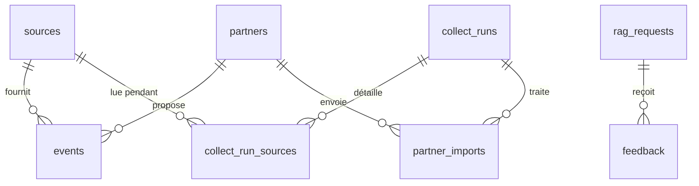

# Base de données

SortirIA utilise **PostgreSQL 16 avec l'extension pgvector** : les filtres
stricts (date, zone, budget, public) et la recherche sémantique se font dans la
même base, et souvent dans la même requête.

Le schéma est dans `sql/sortiria/`, en fichiers numérotés exécutés dans l'ordre.
Il a été écrit pour SortirIA le 13/10/2026 (`events`, `collect_runs`,
`rag_requests`) puis complété le 14/10/2026 (sources, partenaires, avis, cache,
publics, vues). Les anciens fichiers de CheckIt.AI, qui décrivaient des articles
de presse étiquetés, sont rangés dans `reference/sql_checkit/`.

## Créer ou mettre à jour la base

```bash
docker compose up -d db                      # base vide : le schéma est créé tout seul
uv run python -m scripts.init_db             # base existante : mise à jour
uv run python -m scripts.init_db --verifier  # liste les tables et vues
```

Les fichiers sont réexécutables : relancer `init_db` après une modification du
schéma conserve les données.

## Les tables et leurs liens



| Fichier | Table | Une ligne par | À quoi elle sert |
| --- | --- | --- | --- |
| `01_sources.sql` | `sources` | source déclarée | Licence et texte d'attribution affiché sous chaque proposition. Un événement d'une source non déclarée est refusé. |
| | `partners` | professionnel partenaire | Organisation seulement : les coordonnées des personnes restent hors de la base (RGPD). |
| | `partner_imports` | fichier reçu d'un partenaire | Bilan de l'import ; l'empreinte SHA-256 empêche d'importer deux fois le même fichier. |
| `02_events.sql` | `events` | événement unique (une séance), après déduplication | Ce que le RAG filtre et recherche (embedding Mistral de 1 024 dimensions). `source_credit` et `source_updated_at` gardent le producteur de la fiche et sa date de mise à jour, à citer d'après la Licence Ouverte. |
| `03_collect.sql` | `collect_runs` | collecte nocturne | Statut et compteurs de la nuit. |
| | `collect_run_sources` | source lue pendant une collecte | Les décisions de l'agent : essais, statut (`ok`, `partiel`, `echec`), événements apportés. |
| `04_rag.sql` | `rag_requests` | question posée | Contraintes, événements proposés, **réponse rédigée**, mode dégradé, latence, tokens, coût en dollars, versions. |
| | `feedback` | avis sur une proposition | Pouce en haut ou en bas ; reste après la suppression de l'événement. |
| | `query_cache` | réponse en cache | Même question, même jour, mêmes données : pas d'appel à Mistral. |

## Les règles que la base garantit

Ces règles sont des contraintes PostgreSQL : même un bug dans le code ne peut
pas les contourner.

- Un événement mis en avant (`is_sponsored`) a forcément un partenaire.
- Les publics possibles sont `famille` et `soiree` ; l'âge minimal ne dépasse
  pas l'âge maximal ; la fin ne précède pas le début.
- Un avis vaut `-1` ou `1`, une seule fois par proposition.

## Les vues

| Vue | Contenu |
| --- | --- |
| `v_upcoming_events` | Les événements proposables : ni annulés, ni reportés, ni passés, ni uniquement en ligne. **Le RAG lit cette vue, pas la table.** |
| `v_coverage` | Nombre d'événements par zone (Montpellier, bassin de Thau, hors zone), dont gratuits, famille, soirée. |
| `v_collect_health` | Historique des collectes, pour le tableau de bord. |
| `v_daily_quality` | Par jour : requêtes, taux de cache, latence P95, part de réponses dégradées, coût, part d'avis positifs. |

## Identifiant d'un événement

`event_id` (16 caractères hexadécimaux) est tiré de la clé titre + jour +
heure de début (quand elle est connue) + lieu, normalisés
(`event_normalizer.build_dedup_key`). Deux sources qui annoncent le même
concert produisent la même ligne ; deux séances d'un film le même jour au même
cinéma sont deux lignes (ajout de l'heure le 15/10/2026). Un événement sans
heure garde une clé par jour. Changer cette règle change tous les identifiants :
à faire avant l'ouverture au public, jamais après (les notes des clients y
sont attachées).

## Décisions du 15/10/2026 (tables définitives)

- `collect_run_sources.status` accepte `partiel` : l'extracteur a rendu des
  événements mais une partie de sa lecture a échoué ; l'agent ne balaie pas
  ses événements et une telle nuit ne sert pas de référence de baisse.
- `rag_requests.answer` et `rag_requests.degraded` : la réponse rédigée est
  gardée pour rejouer le jeu de test, la faire juger par Mistral et comparer
  deux consignes ; `cost_eur` devient `cost_usd` (même unité que `collect_runs`).
- `event_ratings` gardait déjà le titre et la date de l'événement noté : l'API
  et l'interface les affichent avec chaque commentaire.
- Non retenu pour l'instant : une table de liens événement × source (afficher
  « sources : OpenAgenda, DATAtourisme »), une demi-journée pour un gain de
  présentation.

## Publics et statuts OpenAgenda

`src/event/openagenda_mapper.py` remplit les nouvelles colonnes :

- `status` et `attendance` viennent des codes OpenAgenda (`status` 1 à 6,
  `attendanceMode` 1 à 3). Un événement annulé, reporté ou uniquement en ligne
  est rejeté dès la validation (`annule_ou_reporte`, `en_ligne_uniquement`).
- `age_min`, `age_max` et `accessibility` viennent des champs `age` et
  `accessibility`.
- `audiences` est déduit par des règles simples, faute de champ « public »
  dans OpenAgenda : `famille` si l'âge maximal est de 12 ans ou moins ou si un
  mot comme « jeune public » apparaît (jamais si l'âge minimal est de 18 ans) ;
  `soiree` si l'événement commence à 21 h ou plus tard, ou si un mot comme
  « soirée » ou « DJ » apparaît.

## Événements disparus de leur source

À chaque collecte, l'agent met à jour `last_seen_at` des événements revus,
puis supprime ceux de la même source qui ne l'ont pas été (retirés de
l'agenda, ou désormais refusés par la validation). Il ne le fait que pour une
source lue sans échec et qui a renvoyé au moins un événement : une API en
panne ne vide jamais la base. Le nombre est noté dans `collect_runs.events_removed`.

## Taille de la base et fenêtre de 3 mois (14/10/2026)

- **Persistance** : les données sont dans le volume Docker `pgdata` ; elles
  survivent à un redémarrage (seul `docker compose down -v` les efface).
- **Fenêtre** : toutes les sources collectent les 3 prochains mois
  (`days_forward: 90` dans les valeurs communes de `config/sources.yaml`), et
  la vue `v_upcoming_events` ne propose que ce qui commence dans les 3 mois.
- **Plafond de sécurité** : 10 000 événements au plus
  (`SORTIRIA_MAX_EVENEMENTS`). Au-delà, l'agent retire les plus lointains
  (les plus proches sont ceux qui sont proposés) et alerte ; il alerte aussi
  dès 90 % de remplissage.
- **Statistiques des événements supprimés, pas les événements** : chaque
  suppression (passé, disparu de sa source, plafond) ajoute ses comptes à
  `deleted_event_stats` (jour, source, motif, catégorie, zone, dont familles,
  dont soirées) dans la même requête SQL. La fiche est supprimée ; ce qui a
  été proposé reste mesurable (tendances, offre par zone et par public).
- **Zones** : fonction `sortiria.event_zone(latitude, longitude, commune)`,
  la commune d'abord (31 communes de la Métropole, 14 de Sète agglopôle),
  puis le GPS ; même règle que l'agent (`agent/watch.py`).

## Notes des clients (14/10/2026)

Un client note un événement qu'il a vécu, de 1 à 5 étoiles, avec un court
commentaire facultatif (table `event_ratings`, à ne pas confondre avec
`feedback`, le pouce sur une réponse de l'assistant).

| Règle | Comment |
| --- | --- |
| Après l'avoir vécu | Notation ouverte du début de l'événement à 7 jours après sa fin, vérifiée dans la requête SQL ; les événements passés restent donc 7 jours en base, sans être proposés |
| Une note par client et par événement | Contrainte `event_ratings_once` ; une nouvelle note remplace l'ancienne |
| Anonymat | `user_key` = SHA-256(`RATING_SALT` + identifiant de session) ; ni nom ni courriel |
| Commentaire modéré | 300 caractères au plus, Mistral Moderation avant publication (`publie` / `refuse`) ; `en_attente` si le service ne répond pas, repris par l'agent la nuit suivante |
| La note survit à l'événement | Elle garde lieu, commune, zone, catégorie et partenaire : `v_venue_ratings` (moyenne par lieu, 3 notes au moins) et `v_partner_ratings` |
| Utilisée pour proposer | `v_upcoming_events` expose `venue_rating` et `venue_rating_count` pour le classement du RAG |

API : `POST /events/{event_id}/notes` et `GET /events/{event_id}/notes`
(`app/ratings_api.py`). L'agent alerte si un partenaire a 2,5/5 ou moins sur
5 notes au moins.

## Conservation des données

`SELECT * FROM sortiria.purge_old_data();` supprime les questions de plus de
90 jours (et leurs avis), les entrées de cache expirées et les collectes de
plus d'un an. L'agent l'appellera à la fin de chaque collecte nocturne.

## Tests

`tests/event/test_schema_postgres.py` vérifie le schéma sur un vrai
PostgreSQL : réexécution, contraintes, vues, purge, et aller-retour avec le code
Python. Ces tests ne tournent que si `SORTIRIA_TEST_DATABASE_URL` pointe vers
une base dont le nom contient « test » :

```bash
docker compose exec db createdb -U sortiria sortiria_test
SORTIRIA_TEST_DATABASE_URL=postgresql://sortiria:<mot de passe>@localhost:5432/sortiria_test \
    uv run pytest tests/event/test_schema_postgres.py
```
