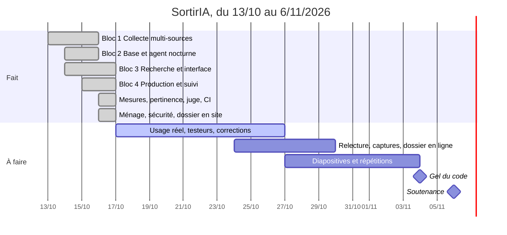

# Feuille de route

*Mise à jour le 16/10/2026.* Le détail, tâche par tâche, avec le code repris
de chaque projet, est dans [Provenance du code](provenance.md).

## Jalons

| Date | Jalon | État |
| --- | --- | --- |
| 13/10/2026 | Démarrage : reprise de CheckIt.AI, du RAG OpenAgenda, de Chess Agent, du triage médical | ✅ |
| 14/10/2026 | Première collecte complète, schéma définitif, interface | ✅ |
| 15/10/2026 | Recherche évaluée (98,7 %), **mise en production sur Azure** | ✅ |
| 16/10/2026 | Déploiement automatique, suivi de la recherche, limite de débit, mesure du coût | ✅ |
| 16/10/2026 | Pertinence mesurée (97,8 %) et juge calibré (98,6 %, confirmé à 91,9 % sur cartes nouvelles), évaluation rejouée en CI, ménage du code hérité, alertes de sécurité corrigées, dossier du projet en site | ✅ |
| 4/11/2026 | **Gel du code** | ⏳ |
| 6/11/2026 | **Soutenance** | ⏳ |

## Les blocs

### Bloc 1 : collecte multi-sources (fait)

Moteur multi-sources de CheckIt.AI adapté aux événements ; OpenAgenda (12
agendas utiles, découverte des nouveaux le dimanche), DATAtourisme (API
officielle), programme PDF de Sète agglopôle lu par Mistral, fichiers des
partenaires ; moteurs iCal, RSS et agendas en ligne prêts. Validation,
normalisation, déduplication, fusion entre sources. **≈ 2 450 événements**.

### Bloc 2 : base et agent nocturne (fait)

PostgreSQL + pgvector, schéma versionné ; agent LangGraph : réessai ciblé,
enrichissement et juge Mistral, surveillance (fraîcheur, couverture, coût),
diagnostic et réparations proposées, bilan par mail, MLflow, Grafana ;
apprentissage des recherches ratées (synonymes, agendas proposés, validation
humaine).

### Bloc 3 : recherche et interface (fait)

Compréhension par règles, recherche hybride sous filtres SQL, élargissement
au sujet, offres partenaires en tête quand elles répondent, rédaction sourcée
par Mistral, cache ; interface Angular (réponse au fil de l'eau, cartes,
détail, avis, pouce haut / bas) ; évaluation sur 50 questions et 125
recherches courtes.

### Bloc 4 : production et suivi (fait, sauf le rejeu en CI)

Azure (Static Web Apps, Container Apps, PostgreSQL Flexible Server), domaine
`www.sortiria-montpellier.fr`, CI/CD avec déploiement à chaque push, limite
de débit, journal des questions, tableau Grafana de la recherche, mesure du
coût et du temps de réponse. **Reste** : rejouer l'évaluation en CI.

### Bloc 5 : sources non structurées (commencé le 16/10)

**Fait** : les PDF et documents Word des partenaires, mis en page librement,
sont lus par Mistral, rangés dans les colonnes du modèle, contrôlés, et
publiés après validation humaine ([Partenaires](partenaires.md)).

**Après la soutenance** : lecture par Mistral des pages HTML des lieux (même principe que les PDF :
titre et date vérifiés dans la page), quand une source le demandera ; base de
lieux ; fine-tuning quand il y aura des données réelles
([Évolutions possibles](evolutions.md)).

## D'ici le gel du code (4/11)

Priorité : **un moteur fiable, mesuré et démontrable**. Plus de nouvelle
fonction ; seulement ce qui mesure, fiabilise ou explique.

| Semaine | Tâches | Livrable |
| --- | --- | --- |
| 16/10 ✅ | Grille de pertinence annotée (50 questions × 3 cartes), juge calibré (v7, figé) ; mesure avec `ministral-8b` (non retenu) | pertinence@3 97,8 %, accord juge / humain 98,6 % |
| 16/10 ✅ | Offres partenaires en tête seulement si type et public correspondent ; « à Montpellier » = la ville | corrections testées |
| 16/10 ✅ | `eval_recherche` rejoué (100 % / 98,7 %) ; évaluation rejouée en CI sur une base figée, sans vecteur ni Mistral ; tests du schéma sur un vrai PostgreSQL en CI | job CI qui échoue sous 95 % |
| 16/10 ✅ | Seconde grille : 50 recherches courtes nouvelles (83,7 %) et les 50 questions après corrections (96,4 %) | juge confirmé sur 135 cartes nouvelles (91,9 %, AC1 0,889) ; sport et loisirs en lieux mesurés (limite voulue) |
| 16/10 ✅ | Ménage : étiquettes vrai / faux de CheckIt.AI retirées (68 tests en moins), `PROVENANCE.md` à jour, variables mortes retirées | 3 568 tests verts |
| 16/10 ✅ | Sécurité des dépendances : Angular 21.2.25 (22 alertes npm corrigées, dont 3 critiques), Airflow 3.3.2 (12 alertes) | 0 alerte npm ; Dependabot à revérifier |
| 16/10 ✅ | Monitoring complet : tableau Grafana « Modèles et coûts » (coût Mistral, tokens par modèle, versions de consigne, avis), Grafana lit la production en lecture seule, juge de pertinence dans MLflow, workflow « Surveillance » toutes les 3 h (site, API, base, collecte), budget Azure | tout le service est suivi, avec une alerte par mail quand il tombe |
| 16/10 ✅ | Propositions de l'agent en **pull request** : une PR par proposition, testée par la CI, Merge = appliquée, Close = refusée ; liens dans le mail, panneau Grafana | l'agent est relu comme un contributeur |
| 16/10 ✅ | Avis des visiteurs lus par l'agent : pouces bas rangés par cause le lundi (leurs mots deviennent des propositions), commentaires refusés contestables (`agent.commentaires`), alerte sur une sortie mal notée | l'avis des visiteurs nourrit l'amélioration |
| 16/10 ✅ | Revue du site en ligne : aucun filtre coché par défaut (la question décide), relances contrôlées (questions courtes), vouvoiement, prix au format français, typographie, filtres repliés sur téléphone ; consigne `2026-10-16.3` ; `robots.txt` (données et robots d'entraînement d'IA exclus) et en-tête `X-Robots-Tag` sur `/api/` | site prêt pour les tests d'usage |
| 17/10 ✅ | Interface : une relance cliquée complète la recherche (un seul choix par bouton, « Plutôt » gardé) ; la question coche Public et Zone ; date lue affichée dans « Quand » ; échanges précédents gardés à l'écran ; moment de la journée lu dans la phrase (le soir, le matin, l'après-midi), « en soirée » distinct du public Soirée ; téléphone : toucher une carte descend au détail ; filtres sur une ligne avec séparateurs | relances et cases cohérentes avec la question, tests |
| 17/10 ✅ | Verbes de pratique : « je veux chanter » cherche karaoké, cours ou stage de chant, pas des concerts (de même danser, jouer, peindre, dessiner, sculpter, cuisiner) ; consigne `2026-10-17.4` ; troisième jeu d'évaluation `eval_pratique.yaml` (20 recherches), rejoué en CI | avant / après (ablation, vraie base) : cartes correctes des recherches de pratique 61 % → 98 %, compréhension 35 % → 100 % ; 125 recherches et 50 questions inchangées |
| 17/10 ✅ | Partenaires : formules gratuit, mis en avant, premium (`partners.formula`), classement entre offres partenaires seulement ; offres affichées une seule fois avant la première question ; pistes « agenda, itinéraire, partage, distance » dans les évolutions | modèle économique à trois niveaux, règle de classement publique |
| 17/10 ✅ | Nuit du 17/10 en échec (fiche DATAtourisme au prix inversé) détectée par la surveillance, corrigée le matin ; l'agent finit désormais toujours par un bilan ; page **Suivi** des incidents et résolutions (doc et dossier) | 20 incidents tracés, de la détection au test |
| 16/10 ✅ | Dossier du projet en site HTML (`docs/dossier/`, 11 pages : besoin, parcours, architecture, agent, recherche, modèles, interface, résultats, déploiement, procédures, limites) ; base de données documentée en entier | dossier lisible par le jury |
| 17-26/10 | **Usage réel** : faire tester le site par 5 à 10 personnes ; lire les pouces bas et les recherches ratées (Grafana, bilan du lundi) ; corrections ciblées ; réponses de Frontignan et de l'Archipel de Thau (intégrer ou citer) | bilan d'usage chiffré, corrections testées |
| 24-30/10 | Relecture du dossier et de la doc ; captures d'écran du site, de Grafana, du mail de bilan ; publication du dossier en ligne (facultatif) ; pitch et feuille de route PDF mis à jour (datés du 14/10) | dossier final |
| 27/10-3/11 | Diapositives, scénario de démonstration, vidéo de secours, répétitions avec questions du jury ; décision sur les partenaires d'exemple (présentés comme fictifs) ; coûts Azure réels du mois relevés | support de soutenance |
| 4/11 | Gel du code : dernier déploiement vert, étiquette git `v1.0` | version présentée |

## Ce qui est volontairement hors du MVP

Voir [MVP et arbitrages](mvp.md) : extraction des contraintes par un modèle
(abandonnée : les règles suffisent), scraping sans autorisation, météo,
Prometheus, base de lieux, fine-tuning.
