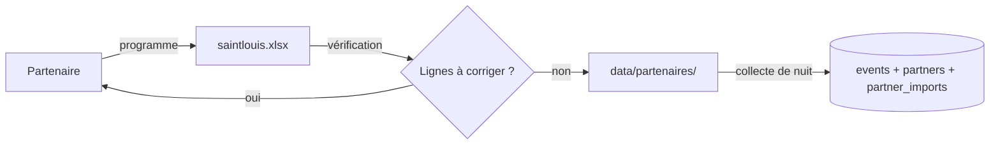
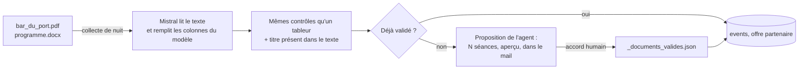

# Fichiers des partenaires

Un professionnel (animation, soirées, activités pour enfants, culture, sport)
envoie sa programmation ; elle entre dans SortirIA à la collecte de nuit,
comme les autres sources, avec son nom cité sous chaque proposition. Pendant
la durée d'un partenariat, ses événements sont « mis en avant », et toujours
signalés comme tels (`is_sponsored`).

## Le circuit

**Un fichier par partenaire, à la racine de `data/partenaires/`, nommé
d'après lui** ; tout ce qui est à la racine est importé chaque nuit :

    data/partenaires/
        saintlouis.xlsx           <- partenaire « Saintlouis »
        bar_truc_muche.csv        <- partenaire « Bar Truc Muche »
        festival.json             <- partenaire « Festival »
        _modeles/                 <- sous-dossier : jamais importé

1. **Envoyer le modèle** : `docs/modeles/modele_partenaire.xlsx` (onglets
   « Programme » à remplir, « Exemple », « Aide ») ou sa version `.csv`.
2. **Vérifier le fichier reçu** (aucune écriture en base) :

        uv run python -m src.extractors.datasets.source.partner_extractor --verifier data/partenaires/saintlouis.xlsx

   Le rapport donne les lignes prêtes et, pour les autres, le numéro de
   ligne et le motif (`date_illisible`, `heure_illisible`, `lieu_manquant`,
   `commune_manquante`, `ages_incoherents`, `lien_invalide`,
   `lien_manquant`...), à renvoyer tel quel au partenaire.
3. **Déposer le fichier** à la racine de `data/partenaires/`, nommé d'après
   le partenaire. Une nouvelle version remplace l'ancienne (même nom). Les
   séances passées sont ignorées sans erreur.
4. **Facultatif** : une entrée dans `config/sources.yaml` (`datasets` >
   `partenaire` > `partners`, clé `file` = nom du fichier sans extension)
   pour donner son vrai nom, son secteur, son site (lien par défaut) et la
   date de fin d'une mise en avant, ou pour le désactiver
   (`enabled: false`). Sans entrée : nom tiré du fichier, secteur « autre »,
   pas de mise en avant, un lien obligatoire sur chaque ligne.

Ignorés : les sous-dossiers, les fichiers qui commencent par `_`, `.` ou
`~$` (fichier ouvert dans Excel), les autres extensions.

Formats : `.xlsx`, `.xls` (premier onglet), `.csv` (séparateur `;` ou `,`),
`.json` (liste d'objets, ou `{"evenements": [...]}`), avec les colonnes (ou
clés) du modèle. Le contenu est légèrement nettoyé : espaces en trop, titres
TOUT EN MAJUSCULES adoucis, communes remises en forme, liens `www.` complétés
en `https://`.

**Exemples fictifs** fournis pour la démonstration : `ludotheque_exemple.xlsx`
(familles), `bar_exemple.csv` (soirées), `festival_exemple.json`. Séances
marquées « (exemple) », liens `example.org` ; à désactiver avant d'ouvrir le
service au public.

## Un PDF ou un document Word, mis en page librement (16/10/2026)

Tous les partenaires ne rempliront pas le modèle : une plaquette PDF, un
programme Word, chacun mis en page à sa façon. Ces fichiers se déposent au
même endroit (`data/partenaires/bar_du_port.pdf`) ; **Mistral les lit**, et
c'est un humain qui décide de leur publication.

1. **Lecture** (`src/extractors/datasets/source/partner_documents.py`) : le
   texte est extrait (PDF par pypdf ; Word directement depuis le fichier,
   tableaux compris), puis Mistral range chaque séance dans **les colonnes du
   modèle** (titre, date, heure, lieu, commune, prix, public…), sans rien
   inventer : ce qui n'est pas écrit reste vide.
2. **Contrôles** : chaque ligne passe par les mêmes règles qu'un tableur
   (date, lieu, commune, lien…), plus une : **le titre doit figurer dans le
   texte** lu, sinon la ligne est écartée (`titre_absent_du_texte`). Le lieu
   et la commune, souvent implicites sur la plaquette d'un lieu, peuvent être
   déclarés pour le partenaire dans `config/sources.yaml` (`venue`, `city`).
3. **Validation humaine** : tant que le document n'est pas validé, **rien
   n'est publié**. L'agent compte les séances lues et **propose** l'import,
   avec un aperçu, dans le mail du matin ; on vérifie, puis on accepte :

       uv run python -m src.extractors.datasets.source.partner_extractor --verifier data/partenaires/bar_du_port.pdf
       uv run python -m agent.proposals                  # la proposition et son numéro
       uv run python -m agent.proposals --accepter N     # inscrit le fichier et son empreinte

   Le fichier et son empreinte sont inscrits dans
   `data/partenaires/_documents_valides.json` ; il est importé à la collecte
   suivante. Un document modifié (autre empreinte) redemande un accord.
4. **Coût** : le document est lu une fois (cache par empreinte), de l'ordre
   d'un centime pour un programme de quelques pages.

Pourquoi c'est un travail d'agent et pas d'ETL : un ETL lit des colonnes
connues ; une plaquette n'a pas de colonnes. Il faut comprendre le texte
(Mistral), contrôler ce qui en sort (règles), et laisser un humain décider
de ce qui est publié.

Pour essayer : `docs/modeles/exemple_plaquette_partenaire.docx`, plaquette
**fictive** d'un bar sétois (quatre séances en novembre, dont une dans un
tableau) :

    uv run python -m src.extractors.datasets.source.partner_extractor --verifier docs/modeles/exemple_plaquette_partenaire.docx

Non couvert : un tableur Excel très éloigné du modèle (un onglet par mois,
cellules fusionnées) est refusé (« colonnes manquantes ») ; le plus simple
reste de le reprendre dans le modèle, ou de l'enregistrer en PDF.

## Le modèle

Une ligne (ou un objet JSON) par séance. Colonnes obligatoires : `titre`,
`date`, `lieu`, `commune`. Formats acceptés : `25/10/2026` ou `2026-10-25` (ou une vraie date
Excel), `20:30` ou `20h30`, `oui` / `non`. Les noms de colonnes courants d'un
fichier « maison » sont reconnus aussi (`ville`, `tarif`, `heure`, `url`...).

Les colonnes du modèle et celles du lecteur viennent de la même liste
(`TEMPLATE_COLUMNS`, `src/event/partner_mapper.py`) ; le modèle se régénère
avec `uv run python -m scripts.creer_modele_partenaire`.

Le **public** se déduit de la colonne `public` et des âges : « famille »,
« enfants », « jeune public », mais aussi « tout public » ou « tous âges »
donnent le public famille, sauf avec un âge minimal de 18 ans ;
« soirée », « nuit » ou « club » donnent le public soirée.

## Dans la recherche

Une offre partenaire qui répond à la demande (contraintes respectées, type
ou mots demandés présents) passe **en tête des cartes**, avec l'encadré
terracotta « Offre partenaire » ; Mistral la cite en premier. Une offre qui
ne répond pas reste dans « À ne pas manquer », jamais mêlée aux cartes. Le
type se lit aussi dans le titre et la catégorie du fichier : « Atelier jeux »
répond à « jeux », « Soirée DJ » à « soirée ». Détail et contrôle sur les
fichiers d'exemple : page [Interface](interface.md).

Chaque lundi, le bilan de l'agent peut suggérer un sujet à proposer aux
partenaires (« kitesurf : cherché 3 fois, absent de la base et des agendas
de la zone »).

## En base

À chaque collecte, dans la même transaction que les événements :

| Table | Ce qui est écrit |
| --- | --- |
| `partners` | Le partenaire (créé ou mis à jour d'après la configuration) |
| `events` | Ses séances, avec `partner_id`, `is_sponsored` et la source `partenaire` |
| `partner_imports` | Le bilan de chaque fichier : lignes lues, gardées, refusées, motifs, statut (`importe`, `partiel`) ; un même fichier (même empreinte) n'est compté qu'une fois |

Les fichiers des partenaires sont dans `data/partenaires/`, **suivi par git**
(seule exception au `data/` ignoré) et copié dans l'image Docker : un nouveau
fichier, ou un document validé, n'arrive en production qu'après un commit et
un push. Les partenaires d'exemple sont fictifs.

## Choix techniques

- Moteur **datasets** de CheckIt.AI (`src/extractors/datasets/`) avec un
  adaptateur dédié (`src/extractors/datasets/source/partner_extractor.py`),
  comme pour les autres sources : trouver les fichiers, lire les lignes,
  construire les articles ; le moteur fait le reste (filtres, doublons,
  statut).
- Un ajustement du moteur, noté dans le code : la validation propre à la
  source passe avant la construction de l'article (sinon le motif d'une
  ligne refusée était perdu). Le filtre « étiquette vrai/faux » hérité des
  jeux de données de fausses informations de CheckIt.AI a été retiré du code
  le 16/10/2026.
- L'agent ne lance la source que si `data/partenaires/` contient au moins un fichier.
